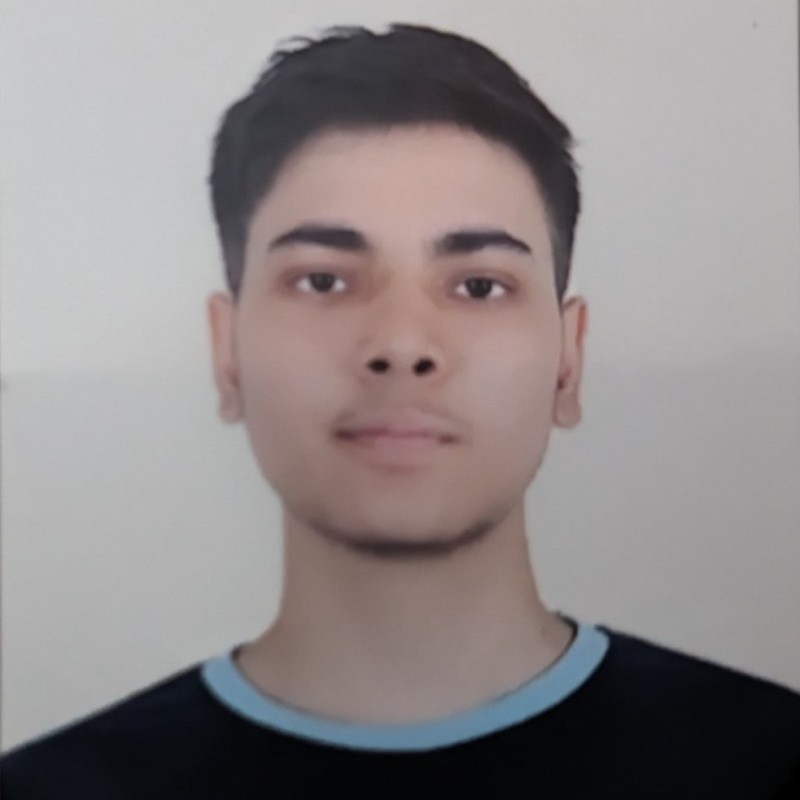
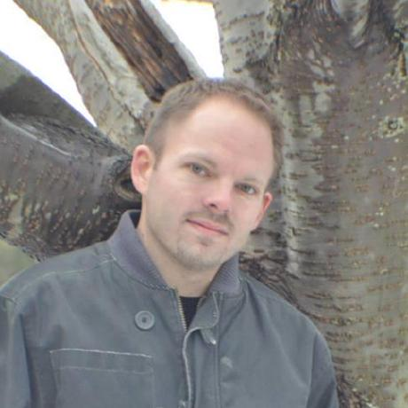
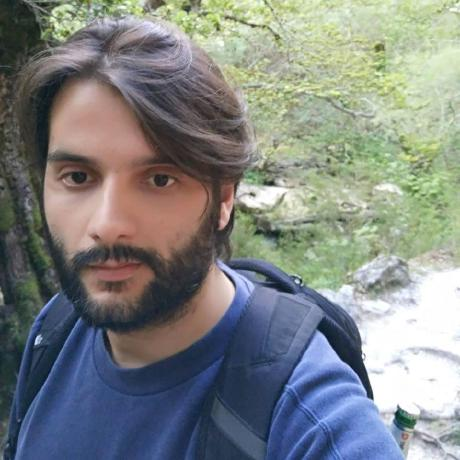
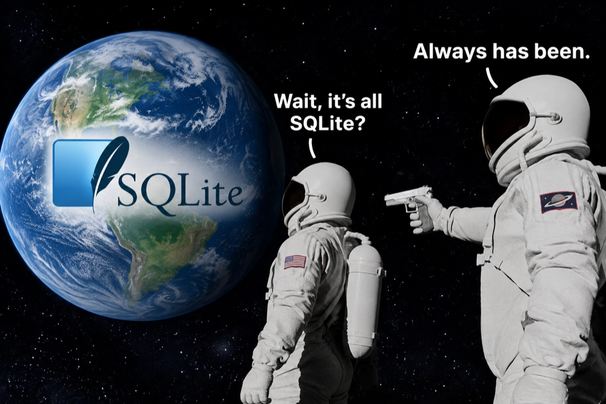
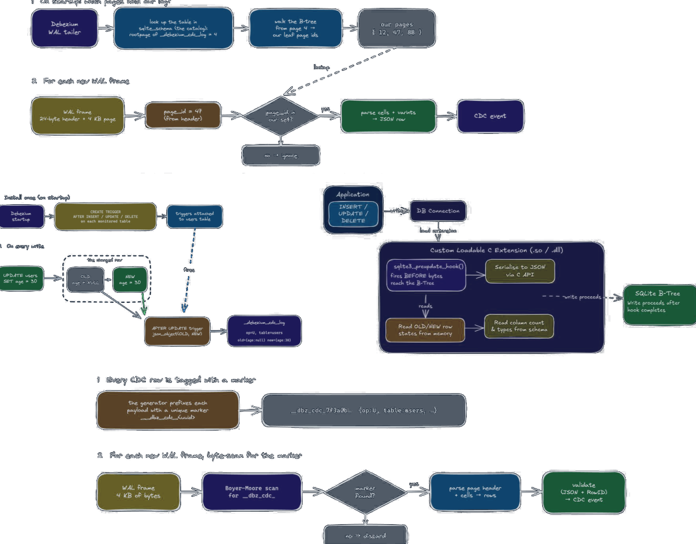
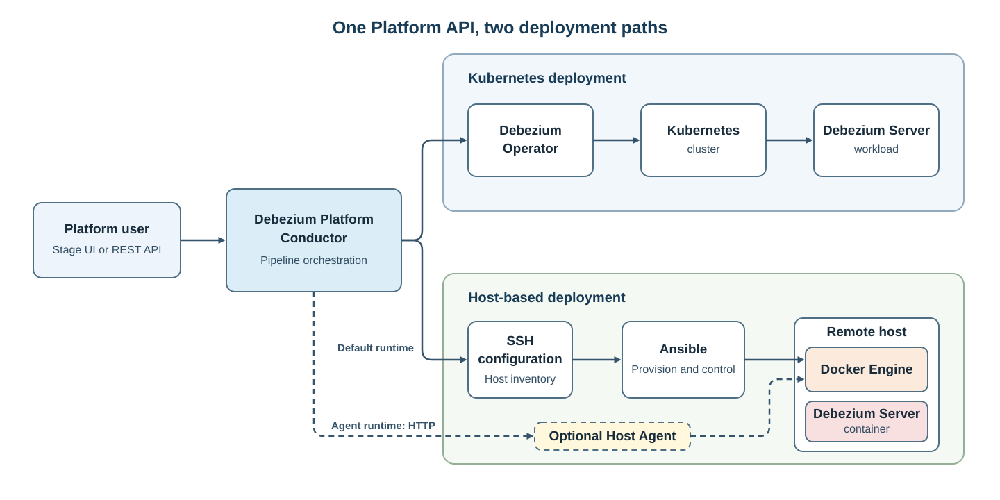
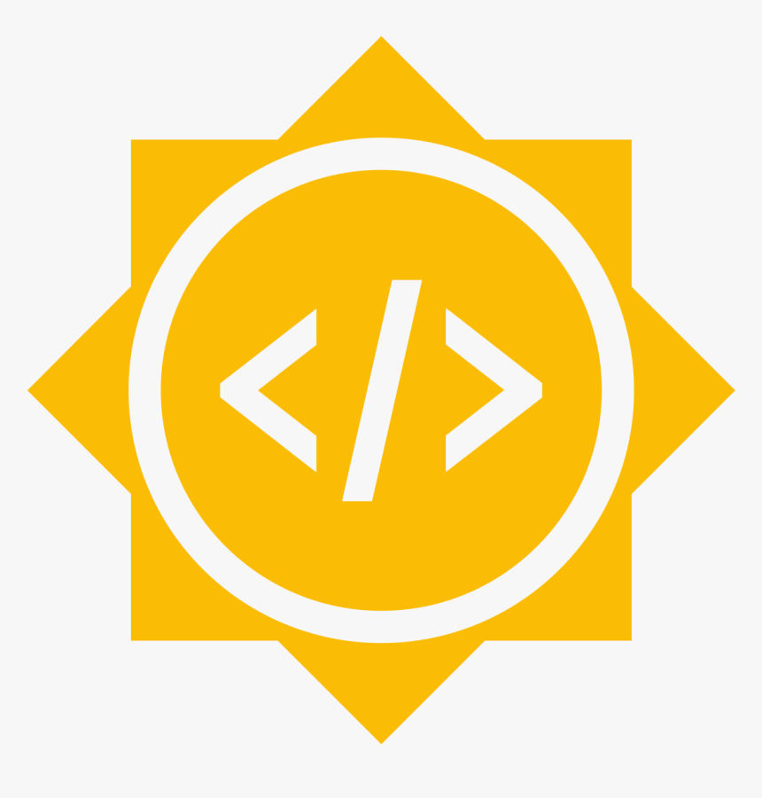

<!-- _class: lead -->

```episode
number: 002
date: November 2026
day: 17
youtube: Q46slutMeSA
special: gsoc2026 | GSoC 2026 Projects Showcase
```

---

```intro
```

---

```agenda
```

---

```speaker special
```

---

<!-- _class: sq sq-cover -->

<style>
/* cover */
section.sq-cover { justify-content: center; padding-top: 40px; }
section.sq-cover .cover { display: grid; grid-template-columns: 1.3fr 1fr; gap: 36px; align-items: center; }
section.sq-cover .thesis { display: flex; flex-direction: column; gap: 14px; }
section.sq-cover .term { border-radius: 14px; overflow: hidden; border: 1px solid var(--dbz-border-strong); background: var(--dbz-bg-deep); box-shadow: 0 24px 60px rgba(0, 0, 0, 0.5); }
section.sq-cover .term.ev { border-color: rgba(145, 212, 67, 0.55); box-shadow: 0 24px 60px rgba(0, 0, 0, 0.5), 0 0 50px rgba(145, 212, 67, 0.12); }
section.sq-cover .term .bar { display: flex; justify-content: space-between; padding: 9px 16px; font-family: 'JetBrains Mono', ui-monospace, monospace; font-size: 12px; letter-spacing: 0.12em; text-transform: uppercase; color: var(--dbz-muted); background: var(--dbz-surface-2); }
section.sq-cover .term pre { margin: 0; padding: 14px 18px; border: 0; border-radius: 0; background: transparent; font-family: 'JetBrains Mono', ui-monospace, monospace; font-size: 16px; line-height: 1.55; color: var(--dbz-text); white-space: pre; }
section.sq-cover .k { color: var(--dbz-accent-strong); } section.sq-cover .s { color: var(--dbz-warn); } section.sq-cover .n { color: #A98BF5; } section.sq-cover .g { color: var(--dbz-brand-strong); } section.sq-cover .m { color: var(--dbz-muted); }
section.sq-cover .arrow { align-self: center; font-family: 'JetBrains Mono', ui-monospace, monospace; font-size: 13px; letter-spacing: 0.12em; text-transform: uppercase; color: var(--dbz-muted); }

section.sq-cover h1 { margin: 0; font-size: 64px; line-height: 0.98; font-weight: 800; letter-spacing: -0.04em; }
section.sq-cover .people { display: flex; align-items: center; gap: 48px; margin-top: 56px; }
section.sq-cover .speaker { display: flex; align-items: center; gap: 22px; }
section.sq-cover .speaker img { width: 116px; height: 116px; border-radius: 50%; object-fit: cover; padding: 4px; background: linear-gradient(135deg, var(--dbz-brand), var(--dbz-accent)); }
section.sq-cover .who b { display: block; font-size: 32px; font-weight: 700; letter-spacing: -0.01em; color: var(--dbz-text); }
section.sq-cover .who span { display: block; margin-top: 4px; font-size: 19px; color: var(--dbz-muted); }
section.sq-cover .mentors { display: flex; flex-direction: column; gap: 14px; padding-left: 48px; border-left: 1px solid var(--dbz-border); }
section.sq-cover .mentor { display: flex; align-items: center; gap: 14px; font-size: 19px; color: var(--dbz-text); font-weight: 600; }
section.sq-cover .mentor img { width: 48px; height: 48px; border-radius: 50%; object-fit: cover; border: 1px solid var(--dbz-border-strong); }
section.sq-cover .mentor small { display: block; font-size: 15px; font-weight: 400; color: var(--dbz-muted); }

/* overrides (kept last so they win) */
section.sq-cover .people { margin-top: 40px; flex-direction: column; align-items: flex-start; gap: 28px; }
section.sq-cover .mentors { padding-left: 0; border-left: 0; flex-direction: row; flex-wrap: wrap; gap: 12px 32px; }
section.sq-cover .mentors .label { flex-basis: 100%; }
</style>

<div class="cover">
<div>
<div class="eyebrow">GSoC 2026</div>
<h1>Source connector<br>for <em>Milvus</em></h1>
<div class="people">
<div class="speaker"><div class="who"><b>Kartik Angiras</b><span>Speaker &amp; contributor · GSoC 2026</span></div></div>
<div class="mentors">
<div class="label">Mentored by</div>
<div class="mentor"><div>Chris Cranford<small>Senior Principal Software Engineer, IBM</small></div></div>
<div class="mentor"><div>Giovanni Panice<small>Senior Software Engineer, IBM</small></div></div>
</div>
</div>
</div>
<div class="thesis">
<div class="term"><div class="bar"><span>Milvus</span><span>Upsert</span></div><pre><span class="k">curl -X POST</span> milvus.debezium.io/v2/vectordb/entities/insert
<span class="k">-H 'Content-Type: application/json'</span>
<span class="k">-d</span> '{"collectionName": "products", 
"data": [{"pk": 1005, "name":"camping stove", 
"category": "outdoor", "price": 59.99, 
"embedding": [0.1, 0.3, 0.3, 0.5]}]}'</pre>
</div>
<div class="arrow">↓ debezium milvus connector</div>
<div class="term ev"><div class="bar"><span>topic · milvus.default.products</span><span>Event out</span></div><pre>{
  <span class="g">"op"</span>: <span class="s">"c"</span>,
  <span class="g">"before"</span>: <span class="m">null</span>,
  <span class="g">"after"</span>: { <span class="g">"pk"</span>: <span class="n">1005</span>, <span class="g">"price"</span>: <span class="s">"59.99"</span> },
  <span class="g">"source"</span>: { <span class="g">"connector"</span>: <span class="s">"milvus"</span>, <span class="g">"collection"</span>: <span class="s">"products"</span> }
}</pre></div>
</div>
</div>

---

## What is Milvus

---

## What is Milvus

---

## Working on Milvus

---

## Complexity of Milvus

---

## Why and Use Cases

---

## Pipeline Demo

---

## Pipeline Demo

---

## What’s next

---

<!-- _class: sq sq-cover -->

<style>
/* SQLite connector slides. Layout: eyebrow + display headline + lede, then one native visual that fills the rest. */
section.sq {
  --sq-line: #3A5B66; --sq-int: #48BFE0; --sq-real: #A98BF5; --sq-text: #F0A828; --sq-blob: #F07A8A; --sq-null: #8296A3;
  --sq-ready: #F07A8A; --sq-set: #F0A828; --sq-go: #91D443;
  display: flex; flex-direction: column; justify-content: flex-start; padding: 58px 72px 66px;
}
section.sq .eyebrow { display: flex; align-items: center; gap: 12px; margin: 0 0 14px; font-family: 'JetBrains Mono', ui-monospace, monospace; font-size: 15px; font-weight: 600; letter-spacing: 0.16em; text-transform: uppercase; color: var(--dbz-accent-strong); }
section.sq .eyebrow { gap: 0; color: rgba(164, 181, 193, 0.55); }
section.sq .eyebrow span { display: flex; align-items: center; gap: 10px; }
section.sq .eyebrow span + span::before { order: -2; content: ''; width: 26px; height: 1px; margin: 0 14px 0 4px; background: var(--dbz-border-strong); }
section.sq .eyebrow span.on { color: var(--dbz-accent-strong); }
section.sq .eyebrow span.on::after { content: ''; order: -1; width: 10px; height: 10px; border-radius: 2px; background: linear-gradient(135deg, var(--dbz-brand), var(--dbz-accent)); }
section.sq-cover .eyebrow::before { content: ''; width: 10px; height: 10px; margin-right: 12px; border-radius: 2px; background: linear-gradient(135deg, var(--dbz-brand), var(--dbz-accent)); }
section.sq-cover .eyebrow { color: var(--dbz-accent-strong); }
section.sq h2 { margin: 0; padding: 0; border: 0; max-width: 960px; font-size: 46px; line-height: 1.08; font-weight: 800; letter-spacing: -0.025em; color: var(--dbz-text); text-wrap: balance; }
section.sq h2 em, section.sq h1 em { font-style: normal; color: transparent; background: linear-gradient(90deg, var(--dbz-brand), var(--dbz-accent)); -webkit-background-clip: text; background-clip: text; }
section.sq .lede { margin: 14px 0 0; max-width: 64ch; font-size: 22px; line-height: 1.45; color: var(--dbz-muted); }
section.sq .lede b { color: var(--dbz-text); font-weight: 600; }
section.sq .lede code, section.sq td code { font-size: 0.86em; }
section.sq .body { flex: 1; min-height: 0; margin-top: 30px; display: flex; gap: 32px; }
section.sq .mono { font-family: 'JetBrains Mono', ui-monospace, monospace; }
section.sq .label { font-family: 'JetBrains Mono', ui-monospace, monospace; font-size: 13px; font-weight: 600; letter-spacing: 0.14em; text-transform: uppercase; color: var(--dbz-muted); }

/* cover */
section.sq-cover { justify-content: center; padding-top: 40px; }
section.sq-cover .cover { display: grid; grid-template-columns: 1.3fr 1fr; gap: 36px; align-items: center; }
section.sq-cover .thesis { display: flex; flex-direction: column; gap: 14px; }
section.sq-cover .term { border-radius: 14px; overflow: hidden; border: 1px solid var(--dbz-border-strong); background: var(--dbz-bg-deep); box-shadow: 0 24px 60px rgba(0, 0, 0, 0.5); }
section.sq-cover .term.ev { border-color: rgba(145, 212, 67, 0.55); box-shadow: 0 24px 60px rgba(0, 0, 0, 0.5), 0 0 50px rgba(145, 212, 67, 0.12); }
section.sq-cover .term .bar { display: flex; justify-content: space-between; padding: 9px 16px; font-family: 'JetBrains Mono', ui-monospace, monospace; font-size: 12px; letter-spacing: 0.12em; text-transform: uppercase; color: var(--dbz-muted); background: var(--dbz-surface-2); }
section.sq-cover .term pre { margin: 0; padding: 14px 18px; border: 0; border-radius: 0; background: transparent; font-family: 'JetBrains Mono', ui-monospace, monospace; font-size: 16px; line-height: 1.55; color: var(--dbz-text); white-space: pre; }
section.sq-cover .k { color: var(--dbz-accent-strong); } section.sq-cover .s { color: var(--dbz-warn); } section.sq-cover .n { color: #A98BF5; } section.sq-cover .g { color: var(--dbz-brand-strong); } section.sq-cover .m { color: var(--dbz-muted); }
section.sq-cover .arrow { align-self: center; font-family: 'JetBrains Mono', ui-monospace, monospace; font-size: 13px; letter-spacing: 0.12em; text-transform: uppercase; color: var(--dbz-muted); }

section.sq-cover h1 { margin: 0; font-size: 64px; line-height: 0.98; font-weight: 800; letter-spacing: -0.04em; }
section.sq-cover .people { display: flex; align-items: center; gap: 48px; margin-top: 56px; }
section.sq-cover .speaker { display: flex; align-items: center; gap: 22px; }
section.sq-cover .speaker img { width: 116px; height: 116px; border-radius: 50%; object-fit: cover; padding: 4px; background: linear-gradient(135deg, var(--dbz-brand), var(--dbz-accent)); }
section.sq-cover .who b { display: block; font-size: 32px; font-weight: 700; letter-spacing: -0.01em; color: var(--dbz-text); }
section.sq-cover .who span { display: block; margin-top: 4px; font-size: 19px; color: var(--dbz-muted); }
section.sq-cover .mentors { display: flex; flex-direction: column; gap: 14px; padding-left: 48px; border-left: 1px solid var(--dbz-border); }
section.sq-cover .mentor { display: flex; align-items: center; gap: 14px; font-size: 19px; color: var(--dbz-text); font-weight: 600; }
section.sq-cover .mentor img { width: 48px; height: 48px; border-radius: 50%; object-fit: cover; border: 1px solid var(--dbz-border-strong); }
section.sq-cover .mentor small { display: block; font-size: 15px; font-weight: 400; color: var(--dbz-muted); }

/* stat hero */
section.sq .hero { flex: 1.15; display: flex; flex-direction: column; justify-content: center; min-width: 0; }
section.sq .big { font-size: 96px; line-height: 0.95; font-weight: 800; letter-spacing: -0.045em; color: transparent; background: linear-gradient(90deg, var(--dbz-brand), var(--dbz-accent)); -webkit-background-clip: text; background-clip: text; }
section.sq .big-cap { margin-top: 10px; font-size: 22px; font-weight: 600; color: var(--dbz-text); }
section.sq .facts { display: grid; grid-template-columns: 1fr 1fr; gap: 24px; margin-top: 30px; padding-top: 22px; border-top: 1px solid var(--dbz-border); font-size: 18px; line-height: 1.4; color: var(--dbz-muted); }
section.sq .facts b { display: block; margin-bottom: 4px; font-size: 19px; color: var(--dbz-text); }
section.sq .src { margin-top: 22px; font-size: 15px; color: var(--dbz-muted); }
section.sq .meme { flex: 1; min-width: 0; display: flex; align-items: center; justify-content: center; }
section.sq .meme img { max-width: 100%; max-height: 100%; border-radius: 16px; border: 1px solid var(--dbz-border-strong); box-shadow: 0 18px 50px rgba(0, 0, 0, 0.45); }

/* fan-out */
section.sq .fan { flex: 1; display: grid; grid-template-columns: 300px 1fr 240px 1fr 250px; grid-template-rows: auto 280px; column-gap: 0; row-gap: 14px; align-self: center; }
section.sq .fan .label { grid-row: 1; }
section.sq .fan .chips { grid-row: 2; display: flex; flex-direction: column; justify-content: space-around; }
section.sq .chip { padding: 12px 16px; border-radius: 10px; font-size: 18px; font-weight: 500; color: var(--dbz-text); background: var(--dbz-surface); border: 1px solid var(--dbz-border); }
section.sq .chips.out .chip { border-color: rgba(145, 212, 67, 0.45); background: rgba(145, 212, 67, 0.07); }
section.sq .fan svg { grid-row: 2; width: 100%; height: 100%; overflow: visible; }
section.sq .fan line { stroke: var(--sq-line); stroke-width: 2; vector-effect: non-scaling-stroke; }
section.sq .fan svg.out line { stroke: var(--dbz-brand); stroke-opacity: 0.7; }
section.sq .hub { grid-row: 2; align-self: center; padding: 3px; border-radius: 16px; background: linear-gradient(135deg, var(--dbz-brand), var(--dbz-accent)); box-shadow: 0 0 40px rgba(72, 191, 224, 0.25); }
section.sq .hub div { padding: 18px 18px; border-radius: 13px; background: var(--dbz-bg); text-align: center; }
section.sq .hub small { display: block; font-family: 'JetBrains Mono', ui-monospace, monospace; font-size: 13px; letter-spacing: 0.14em; text-transform: uppercase; color: var(--dbz-accent-strong); }
section.sq .hub b { display: block; margin-top: 4px; font-size: 22px; color: var(--dbz-text); }

/* design tree */
section.sq .tree { flex: 1.05; min-width: 0; display: flex; flex-direction: column; align-items: center; }
section.sq .tree .root { padding: 10px 26px; border-radius: 999px; font-weight: 700; font-size: 20px; color: var(--dbz-on-fill); background: var(--dbz-accent); }
section.sq .branches { position: relative; display: grid; grid-template-columns: 1fr 1fr; gap: 28px; width: 100%; margin-top: 30px; }
section.sq .branches::before { content: ''; position: absolute; top: -16px; left: 25%; right: 25%; height: 16px; border: 2px solid var(--sq-line); border-bottom: 0; border-radius: 10px 10px 0 0; }
section.sq .branches::after { content: ''; position: absolute; top: -30px; left: 50%; width: 2px; height: 14px; background: var(--sq-line); }
section.sq .branch { display: flex; flex-direction: column; gap: 10px; }
section.sq .branch .bh { margin-bottom: 4px; text-align: center; font-size: 19px; font-weight: 700; color: var(--dbz-text); }
section.sq .opt { display: flex; justify-content: space-between; align-items: center; padding: 11px 16px; border-radius: 10px; font-size: 18px; color: var(--dbz-muted); border: 1px dashed var(--dbz-border-strong); }
section.sq .opt.win { color: var(--dbz-text); font-weight: 600; border: 1px solid var(--dbz-brand); background: rgba(145, 212, 67, 0.1); }
section.sq .opt.win span { font-family: 'JetBrains Mono', ui-monospace, monospace; font-size: 13px; font-weight: 700; padding: 2px 8px; border-radius: 6px; color: var(--dbz-on-fill); background: var(--dbz-brand); }
section.sq .grave { flex: 1.25; min-width: 0; display: flex; flex-direction: column; gap: 12px; }
section.sq .grave .frame-img { flex: 1; min-height: 0; display: flex; align-items: center; justify-content: center; padding: 14px; border-radius: 14px; background: var(--dbz-bg-deep); border: 1px solid var(--dbz-border); }
section.sq .grave img { max-width: 100%; max-height: 100%; opacity: 0.9; filter: saturate(0.85); }
section.sq .stones { flex: 1; display: grid; grid-template-columns: repeat(3, 1fr); gap: 14px; align-items: end; }
section.sq .stone { display: flex; flex-direction: column; align-items: center; gap: 8px; height: 100%; max-height: 300px; padding: 30px 14px 18px; text-align: center; border-radius: 90px 90px 10px 10px; background: linear-gradient(180deg, #1F3140, var(--dbz-surface)); border: 1px solid var(--dbz-border-strong); box-shadow: inset 0 2px 0 rgba(255, 255, 255, 0.05), 0 14px 0 -6px var(--dbz-bg-deep); }
section.sq .stone:nth-child(2) { max-height: 330px; }
section.sq .stone small { font-family: 'JetBrains Mono', ui-monospace, monospace; font-size: 14px; font-weight: 700; letter-spacing: 0.3em; color: var(--dbz-muted); }
section.sq .stone b { font-size: 19px; line-height: 1.2; color: var(--dbz-text); }
section.sq .stone p { margin: 0; font-size: 14px; line-height: 1.45; color: var(--dbz-muted); }
section.sq .stone code { font-size: 12px; overflow-wrap: anywhere; }

/* capture flow + log table */
section.sq .stack { flex: 1; min-width: 0; display: flex; flex-direction: column; gap: 26px; }
section.sq .flow { display: flex; align-items: center; gap: 10px; }
section.sq .node { flex-shrink: 0; padding: 13px 16px; border-radius: 10px; text-align: center; font-size: 19px; font-weight: 600; line-height: 1.25; color: var(--dbz-text); background: var(--dbz-surface-2); border: 1px solid var(--dbz-border-strong); }
section.sq .node small { display: block; font-size: 14px; font-weight: 400; color: var(--dbz-muted); }
section.sq .node.log { font-family: 'JetBrains Mono', ui-monospace, monospace; font-size: 16px; color: var(--sq-text); border-color: rgba(240, 168, 40, 0.6); background: rgba(240, 168, 40, 0.08); }
section.sq .node.conn { color: var(--dbz-on-fill); background: linear-gradient(135deg, var(--dbz-brand), var(--dbz-accent)); border: 0; }
section.sq .node.conn small { color: rgba(7, 15, 22, 0.7); }
section.sq .db { position: relative; display: flex; align-items: center; gap: 10px; padding: 26px 14px 14px; border-radius: 14px; border: 1px dashed var(--dbz-border-strong); }
section.sq .db .label { position: absolute; top: 7px; left: 14px; font-size: 11px; }
section.sq .edge { flex: 1; min-width: 56px; display: flex; flex-direction: column; align-items: center; gap: 5px; font-family: 'JetBrains Mono', ui-monospace, monospace; font-size: 12px; color: var(--dbz-muted); white-space: nowrap; font-size: 13px; }
section.sq .edge i { position: relative; display: block; width: 100%; height: 2px; background: var(--sq-line); }
section.sq .edge i::after { content: ''; position: absolute; right: -1px; top: -5px; border-left: 9px solid var(--sq-line); border-top: 6px solid transparent; border-bottom: 6px solid transparent; }
section.sq table.log { width: 100%; border-collapse: separate; border-spacing: 0; font-family: 'JetBrains Mono', ui-monospace, monospace; font-size: 15px; border: 1px solid var(--dbz-border); border-radius: 12px; overflow: hidden; }
section.sq table.log th { padding: 10px 14px; text-align: left; font-size: 13px; font-weight: 600; color: var(--sq-text); background: var(--dbz-surface-2); border: 0; }
section.sq table.log td { padding: 9px 14px; color: var(--dbz-text); background: var(--dbz-surface); border: 0; border-top: 1px solid var(--dbz-border); }
section.sq table.log td.nil { color: var(--sq-null); font-style: italic; }
section.sq .op { display: inline-block; width: 24px; text-align: center; border-radius: 5px; font-weight: 700; color: var(--dbz-on-fill); }
section.sq .op.c { background: var(--dbz-brand); } section.sq .op.u { background: var(--dbz-warn); } section.sq .op.d { background: var(--sq-blob); }

/* pipeline */

/* type affinity */
section.sq .affwrap { flex: 1.35; min-width: 0; display: flex; flex-direction: column; gap: 12px; }
section.sq table.aff { width: 100%; border-collapse: separate; border-spacing: 0; font-size: 18px; border: 1px solid var(--dbz-border); border-radius: 12px; overflow: hidden; }
section.sq table.aff caption { caption-side: top; padding: 0 0 10px; text-align: left; }
section.sq table.aff th { padding: 10px 18px; text-align: left; font-size: 14px; font-weight: 600; letter-spacing: 0.04em; color: var(--dbz-muted); background: var(--dbz-surface-2); border: 0; }
section.sq table.aff td { padding: 9px 18px; font-family: 'JetBrains Mono', ui-monospace, monospace; color: var(--dbz-text); background: var(--dbz-surface); border: 0; border-top: 1px solid var(--dbz-border); }
section.sq .sc { display: inline-block; min-width: 92px; padding: 3px 10px; border-radius: 6px; text-align: center; font-family: 'JetBrains Mono', ui-monospace, monospace; font-size: 14px; font-weight: 700; color: var(--dbz-on-fill); }
section.sq .sc.int { background: var(--sq-int); } section.sq .sc.real { background: var(--sq-real); } section.sq .sc.text { background: var(--sq-text); } section.sq .sc.blob { background: var(--sq-blob); } section.sq .sc.null { background: var(--sq-null); }
section.sq .classes { flex: 1; min-width: 0; display: flex; flex-direction: column; gap: 14px; }
section.sq .classes .row { display: flex; flex-wrap: wrap; gap: 8px; }
section.sq .classes p { margin: 8px 0 0; font-size: 19px; line-height: 1.5; color: var(--dbz-muted); }
section.sq .classes p b { color: var(--dbz-text); }

/* roadmap */
section.sq .road { position: relative; display: grid; grid-template-columns: repeat(4, 1fr); gap: 28px; align-content: start; padding-top: 6px; }
section.sq .road::before { content: ''; position: absolute; top: 20px; left: 10px; right: -20px; height: 2px; background: linear-gradient(90deg, var(--dbz-brand), var(--sq-line) 30%); }
section.sq .road::after { content: ''; position: absolute; top: 15px; right: -24px; border-left: 11px solid var(--sq-line); border-top: 6px solid transparent; border-bottom: 6px solid transparent; }
section.sq .mile { position: relative; display: flex; flex-direction: column; gap: 8px; }
section.sq .mile .pin { width: 26px; height: 26px; margin-bottom: 14px; border-radius: 50%; background: var(--dbz-bg); border: 3px solid var(--dbz-accent); }
section.sq .mile.now .pin { background: var(--dbz-brand); border-color: var(--dbz-brand); box-shadow: 0 0 0 6px rgba(145, 212, 67, 0.2); }
section.sq .mile .label { color: var(--dbz-accent-strong); }
section.sq .mile.now .label { color: var(--dbz-brand-strong); }
section.sq .mile b { font-size: 23px; line-height: 1.2; letter-spacing: -0.01em; color: var(--dbz-text); }
section.sq .mile p { margin: 0; font-size: 17px; line-height: 1.45; color: var(--dbz-muted); }
section.sq .cta { display: flex; align-items: center; justify-content: space-between; margin-top: 56px; padding: 18px 26px; border-radius: 14px; background: var(--dbz-surface); border: 1px solid var(--dbz-border); font-size: 22px; font-weight: 600; color: var(--dbz-text); }
section.sq .cta span { font-family: 'JetBrains Mono', ui-monospace, monospace; font-size: 18px; padding: 6px 14px; border-radius: 8px; color: var(--dbz-on-fill); background: var(--dbz-brand); }

/* overrides (kept last so they win) */
section.sq-cover .people { margin-top: 40px; flex-direction: column; align-items: flex-start; gap: 28px; }
section.sq-cover .mentors { padding-left: 0; border-left: 0; flex-direction: row; flex-wrap: wrap; gap: 12px 32px; }
section.sq-cover .mentors .label { flex-basis: 100%; }
section.sq .stones { align-items: end; }
section.sq .stone { height: auto; max-height: none; justify-content: flex-start; padding: 34px 16px 34px; }
section.sq .stone:nth-child(2) { padding-top: 54px; }
section.sq .stone p { font-size: 15px; }
section.sq .tree { flex: 1.05; }
section.sq .grave { flex: 1.2; }
section.sq .opt { font-size: 17px; padding: 10px 14px; }
section.sq .branch .bh { font-size: 18px; }
section.sq .branches { gap: 20px; }
section.sq .grave .frame-img { padding: 8px; }
section.sq .body { margin-top: 26px; }
section.sq .grave img { opacity: 1; filter: none; }
section.sq .rip { display: flex; flex-wrap: wrap; gap: 8px; }
section.sq .rip span { padding: 4px 12px; border-radius: 999px; font-size: 15px; color: var(--dbz-muted); border: 1px solid var(--dbz-border-strong); text-decoration: line-through; text-decoration-color: rgba(240, 122, 138, 0.7); }
section.sq .rip span::before { content: 'RIP · '; font-family: 'JetBrains Mono', ui-monospace, monospace; font-size: 12px; letter-spacing: 0.1em; text-decoration: none; display: inline-block; color: var(--sq-blob); }
section.sq-demo .body { margin-top: 28px; align-items: stretch; }
section.sq .player { flex: 1; min-width: 0; display: flex; flex-direction: column; border-radius: 14px; overflow: hidden; border: 1px solid var(--dbz-border-strong); background: #000; box-shadow: 0 24px 60px rgba(0, 0, 0, 0.5), 0 0 60px rgba(72, 191, 224, 0.10); }
section.sq .player .bar { display: flex; align-items: center; gap: 7px; padding: 9px 14px; background: var(--dbz-surface-2); font-family: 'JetBrains Mono', ui-monospace, monospace; font-size: 12px; letter-spacing: 0.12em; text-transform: uppercase; color: var(--dbz-muted); }
section.sq .player .bar i { width: 10px; height: 10px; border-radius: 50%; background: var(--dbz-border-strong); }
section.sq .player .bar span { margin-left: 10px; }
section.sq .player .screen { position: relative; flex: 1; }
section.sq .player iframe { position: absolute; inset: 0; width: 100%; height: 100%; border: 0; }
section.sq .notes { width: 250px; flex-shrink: 0; display: flex; flex-direction: column; gap: 16px; justify-content: center; }
section.sq .notes p { margin: 0; font-size: 19px; line-height: 1.5; color: var(--dbz-muted); }
section.sq .notes .ops { display: flex; gap: 8px; }
section.sq .notes .op { width: 34px; padding: 3px 0; font-family: 'JetBrains Mono', ui-monospace, monospace; font-size: 16px; }
section.sq .notes a { font-size: 16px; }
section.sq .label .tomb { font-size: 18px; letter-spacing: 0; vertical-align: -2px; }
section.sq.sq-demo { padding-top: 44px; padding-bottom: 56px; }
section.sq-demo h2 { font-size: 30px; }
section.sq-demo .body { flex: none; justify-content: center; margin-top: 18px; }
section.sq-demo .player { flex: none; width: 816px; }
section.sq-demo .player .bar { padding: 7px 14px; }
section.sq-demo .player .screen { flex: none; height: 510px; }
section.sq:not(.sq-cover) { padding-top: 64px; }
section.sq .vs { flex: 1; align-self: center; display: grid; grid-template-columns: 1fr auto 1fr; gap: 22px; align-items: stretch; }
section.sq .side { padding: 26px 26px 30px; }
section.sq .side { min-width: 0; display: flex; flex-direction: column; gap: 22px; padding: 22px 24px; border-radius: 16px; background: var(--dbz-surface); border: 1px solid var(--dbz-border); }
section.sq .side.emb { border-color: rgba(72, 191, 224, 0.5); box-shadow: 0 0 40px rgba(72, 191, 224, 0.08); }
section.sq .side.emb > .label { color: var(--dbz-accent-strong); }
section.sq .versus { align-self: center; font-family: 'JetBrains Mono', ui-monospace, monospace; font-size: 18px; font-weight: 700; color: var(--dbz-muted); }
section.sq .mini { display: flex; align-items: center; gap: 8px; min-height: 104px; }
section.sq .mini .node { font-size: 16px; padding: 10px 12px; }
section.sq .mini .edge { min-width: 40px; font-size: 11px; }
section.sq .node.srv { border-color: var(--dbz-border-strong); background: var(--dbz-surface-2); }
section.sq .node.lib { color: var(--dbz-on-fill); background: var(--dbz-accent); border: 0; }
section.sq .node.file { font-family: 'JetBrains Mono', ui-monospace, monospace; color: var(--sq-text); border-color: rgba(240, 168, 40, 0.6); background: rgba(240, 168, 40, 0.08); }
section.sq .proc { position: relative; display: flex; align-items: center; gap: 8px; padding: 24px 10px 10px; border-radius: 12px; border: 1px dashed var(--dbz-accent); }
section.sq .proc .label { position: absolute; top: 6px; left: 10px; font-size: 10px; color: var(--dbz-accent-strong); }
section.sq .pts { margin: 0; padding: 0; list-style: none; display: flex; flex-direction: column; gap: 12px; }
section.sq .pts li { margin: 0; position: relative; padding-left: 30px; font-size: 18px; line-height: 1.4; color: var(--dbz-text); }
section.sq .pts li::before { position: absolute; left: 0; top: 1px; width: 20px; height: 20px; border-radius: 50%; display: flex; align-items: center; justify-content: center; font-size: 12px; font-weight: 800; color: var(--dbz-on-fill); }
section.sq .pts li.yes::before { content: '✓'; background: var(--dbz-brand); }
section.sq .pts li.no::before { content: '✕'; background: var(--sq-blob); }
section.sq .tlog { flex: 1; align-self: center; border-radius: 14px; overflow: hidden; border: 1px solid var(--dbz-border-strong); background: var(--dbz-bg-deep); box-shadow: 0 24px 60px rgba(0,0,0,.5); }
section.sq .tlog .tbar { display: flex; align-items: center; gap: 7px; padding: 10px 16px; background: var(--dbz-surface-2); font-family: 'JetBrains Mono', monospace; font-size: 13px; letter-spacing: .1em; text-transform: uppercase; color: var(--dbz-muted); }
section.sq .tlog .tbar i { width: 11px; height: 11px; border-radius: 50%; background: var(--dbz-border-strong); } section.sq .tlog .tbar span { margin-left: 10px; }
section.sq .tlog pre { margin: 0; padding: 18px 24px; border: 0; background: transparent; font-family: 'JetBrains Mono', monospace; font-size: 19px; line-height: 1.75; color: var(--dbz-text); white-space: pre; }
section.sq .tg { display: inline-block; padding: 0 8px; margin-right: 10px; border-radius: 5px; font-weight: 700; font-size: 15px; color: var(--dbz-on-fill); }
section.sq .tg.r { background: var(--sq-ready); } section.sq .tg.s { background: var(--sq-set); } section.sq .tg.g { background: var(--sq-go); }
section.sq .tlog .ok { color: var(--dbz-brand); } section.sq .tlog .v { color: var(--dbz-accent-strong); }
section.sq .tlog .tchip { display: inline-block; white-space: nowrap; line-height: 1.4; padding: 1px 9px; border-radius: 5px; font-size: 15px; font-weight: 700; }
section.sq .tlog .tchip.s { color: var(--sq-set); border: 1px solid var(--sq-set); } section.sq .tlog .tchip.g { color: var(--sq-go); border: 1px solid var(--sq-go); } section.sq .tlog .tchip.k { color: var(--sq-real); border: 1px solid var(--sq-real); }
section.sq .tlog .cur { color: var(--dbz-accent); }
section.sq .stat-body { margin-top: 36px; align-items: center; gap: 48px; }
section.sq .stat-body .hero { justify-content: center; }
section.sq .stat-body .big { font-size: 112px; }
section.sq .stat-body .facts { margin-top: 26px; }
section.sq .stat-body .src { margin-top: 18px; font-size: 14px; }
section.sq .doc { align-self: flex-start; margin-top: 18px; padding: 8px 14px; border-radius: 10px; font-size: 16px; font-weight: 600; color: var(--dbz-accent-strong); background: rgba(72, 191, 224, 0.08); border: 1px solid rgba(72, 191, 224, 0.35); }
section.sq .stat-body .meme { align-self: center; }
section.sq table.aff, section.sq table.log { display: table; width: 100%; }
</style>

<div class="cover">
<div>
<div class="eyebrow">GSoC 2026</div>
<h1>Source connector<br>for <em>SQLite</em></h1>
<div class="people">
<div class="speaker"><div class="who"><b>Siddhant Chaturvedi</b><span>Speaker &amp; contributor · GSoC 2026</span></div></div>
<div class="mentors">
<div class="label">Mentored by</div>
<div class="mentor"><div>Vincenzo Santonastaso<small>Senior Software Engineer, IBM</small></div></div>
<div class="mentor"><div>Giovanni Panice<small>Senior Software Engineer, IBM</small></div></div>
</div>
</div>
</div>
<div class="thesis">
<div class="term"><div class="bar"><span>sqlite3 test.db</span><span>SQL in</span></div><pre><span class="k">INSERT INTO</span> users (id, name)
<span class="k">VALUES</span> (<span class="n">1</span>, <span class="s">'Ada'</span>);</pre></div>
<div class="arrow">↓ debezium sqlite connector</div>
<div class="term ev"><div class="bar"><span>topic · demo.users</span><span>Event out</span></div><pre>{
  <span class="g">"op"</span>: <span class="s">"c"</span>,
  <span class="g">"before"</span>: <span class="m">null</span>,
  <span class="g">"after"</span>: { <span class="g">"id"</span>: <span class="n">1</span>, <span class="g">"name"</span>: <span class="s">"Ada"</span> },
  <span class="g">"source"</span>: { <span class="g">"connector"</span>: <span class="s">"sqlite"</span>, <span class="g">"table"</span>: <span class="s">"users"</span> }
}</pre></div>
</div>
</div>

---

<!-- _class: sq -->

## SQLite is *everywhere*

<p class="lede">With this project, Debezium officially supports SQLite for change data capture.</p>

<div class="body stat-body">
<div class="hero">
<div class="big">1 trillion+</div>
<div class="big-cap">SQLite databases in active use</div>
<div class="facts"><div><b>Nearly everywhere</b>Inside nearly every phone, computer and web browser</div><div><b>Most used</b>Likely used more than all other database engines combined</div></div>
<div class="src">Source: sqlite.org</div>
<a class="doc" href="https://github.com/debezium/debezium-design-documents/pull/49">Design document · debezium-design-documents#49 ↗</a>
</div>
<div class="meme"></div>
</div>

---

<!-- _class: sq -->

## SQLite is a library, *not a server*

<p class="lede">There's no database process to connect to and no replication stream to subscribe to. The whole database is a single file, read and written from inside your app.</p>

<div class="body">
<div class="vs">
<div class="side">
<div class="label">Client–server · PostgreSQL, MySQL</div>
<div class="mini">
<div class="node">Your app</div>
<div class="edge">network<i></i></div>
<div class="node srv">DB server<small>separate process</small></div>
<div class="edge">writes<i></i></div>
<div class="node">Data files</div>
</div>
<ul class="pts">
<li class="yes">Runs as its own server, reached over the network</li>
<li class="yes">Keeps a replication log: WAL or binlog</li>
<li class="yes">Debezium streams it via logical decoding or the binlog</li>
</ul>
</div>
<div class="versus">vs</div>
<div class="side emb">
<div class="label">Embedded · SQLite</div>
<div class="mini">
<div class="proc"><span class="label">Your app process</span><div class="node">Your app</div><div class="edge">calls<i></i></div><div class="node lib">SQLite library</div></div>
<div class="edge">writes<i></i></div>
<div class="node file">test.db<small>one file</small></div>
</div>
<ul class="pts">
<li class="yes">Linked into the app: no server, no network, no setup</li>
<li class="no">Its WAL is a physical log of pages, not of row changes</li>
<li class="no">No replication protocol for CDC to subscribe to</li>
</ul>
</div>
</div>
</div>

---

<!-- _class: sq -->

## SQLite is *everywhere*, but it can't tell you what changed

<p class="lede">It runs on the edge, on devices and inside apps, and every one of those databases holds changes something downstream wants.</p>

<div class="body">
<div class="fan">
<div class="label" style="grid-column:1;">Where SQLite lives</div><div class="label s2" style="grid-column:5;">Where changes go</div>
<div class="chips"><div class="chip">Store checkout terminals</div><div class="chip">Offline-first mobile apps</div><div class="chip">Factory and sensor hubs</div><div class="chip">Desktop apps and browsers</div></div>
<svg class="s2" viewBox="0 0 100 280" preserveAspectRatio="none"><line x1="0" y1="35" x2="100" y2="140"/><line x1="0" y1="105" x2="100" y2="140"/><line x1="0" y1="175" x2="100" y2="140"/><line x1="0" y1="245" x2="100" y2="140"/></svg>
<div class="hub s2"><div><small>Debezium</small><b>SQLite connector</b></div></div>
<svg class="out s2" viewBox="0 0 100 280" preserveAspectRatio="none"><line x1="0" y1="140" x2="100" y2="35"/><line x1="0" y1="140" x2="100" y2="105"/><line x1="0" y1="140" x2="100" y2="175"/><line x1="0" y1="140" x2="100" y2="245"/></svg>
<div class="chips out s2"><div class="chip">Cloud sync</div><div class="chip">Cross-device sync</div><div class="chip">Analytics</div><div class="chip">Any downstream service</div></div>
</div>
</div>

---

<!-- _class: sq -->

## The road to *v1*

<p class="lede">We explored many designs, then settled on the simplest and most efficient.</p>

<div class="body">
<div class="tree">
<div class="root">Streaming</div>
<div class="branches">
<div class="branch"><div class="bh">Logical WAL generator</div><div class="opt win">SQLite triggers <span>v1</span></div><div class="opt">SQLite extensions</div></div>
<div class="branch"><div class="bh">Change extractor</div><div class="opt win">SQLite polling <span>v1</span></div><div class="opt">Unique signature in JSON</div><div class="opt">Full WAL parsing</div></div>
</div>
</div>
<div class="grave">
<div class="label" style="text-align:center;"><span class="tomb">🪦</span> Graveyard of iterations <span class="tomb">🪦</span></div>
<div class="frame-img"></div>
</div>
</div>

---

<!-- _class: sq -->

## SQLite has no change log, so the connector *makes one*

<p class="lede">SQLite's WAL is a physical log of pages. It can't tell us <b>what changed</b>, so the connector keeps a logical log inside the database itself.</p>

<div class="body">
<div class="stack">
<div class="flow">
<div class="node">Your app<small>any driver</small></div>
<div class="edge">writes<i></i></div>
<div class="db"><span class="label">test.db · WAL mode</span><div class="node">users</div><div class="edge">AFTER triggers<i></i></div><div class="node log">_debezium_cdc_log</div></div>
<div class="edge">JDBC poll<i></i></div>
<div class="node conn">Debezium<small>SQLite connector</small></div>
<div class="edge">events<i></i></div>
<div class="node">Kafka<small>demo.users</small></div>
</div>
<table class="log">
<thead><tr><th>change_id</th><th>table_name</th><th>operation</th><th>old_row_data</th><th>new_row_data</th><th>committed_at</th></tr></thead>
<tbody>
<tr><td>1</td><td>users</td><td><span class="op c">c</span></td><td class="nil">NULL</td><td>{"id":1,"name":"Ada"}</td><td>1784023331204</td></tr>
<tr><td>2</td><td>users</td><td><span class="op u">u</span></td><td>{"id":1,"name":"Ada"}</td><td>{"id":1,"name":"Ada L."}</td><td>1784023331877</td></tr>
<tr><td>3</td><td>users</td><td><span class="op d">d</span></td><td>{"id":1,"name":"Ada L."}</td><td class="nil">NULL</td><td>1784023332410</td></tr>
</tbody>
</table>
</div>
</div>

---

<!-- _class: sq -->

## The complete *pipeline*

<p class="lede">Every row and schema change in a SQLite file becomes a live Debezium event.</p>

<div class="body">
<div class="tlog">
<div class="tbar"><i></i><i></i><i></i><span>debezium sqlite connector · test.db</span></div>
<pre>
<span class="tg r">READY </span> <span class="ok">✓</span> PRAGMA journal_mode = <span class="v">wal</span>
<span class="tg r">READY </span> <span class="ok">✓</span> AFTER INSERT / UPDATE / DELETE triggers on <span class="v">users</span>
<span class="tg r">READY </span> <span class="ok">✓</span> <span class="v">_debezium_cdc_log</span> created
<span class="tg s">SET   </span> snapshot <span class="v">users</span> · 3 rows ................ <span class="tchip s">op:&nbsp;r</span>
<span class="tg g">STREAM</span> polling <span class="v">_debezium_cdc_log</span> over JDBC
<span class="tg g">STREAM</span> INSERT users ........................... <span class="tchip g">op:&nbsp;c</span>
<span class="tg g">STREAM</span> UPDATE users ........................... <span class="tchip g">op:&nbsp;u</span>
<span class="tg g">STREAM</span> ALTER TABLE users ...................... <span class="tchip k">schema&nbsp;change</span>
<span class="cur">▍</span></pre>
</div>
</div>

---

<!-- _class: sq -->

## We also handle SQLite's *type affinity*

<p class="lede">SQLite does not enforce types. You can declare a column of type <code>Apple</code>, or store text in an <code>INTEGER</code> column.</p>

<div class="body">
<div class="affwrap">
<div class="label">orders · qty INTEGER</div>
<table class="aff">
<thead><tr><th>id</th><th>qty written</th><th>qty stored as</th></tr></thead>
<tbody>
<tr><td>1</td><td>42</td><td><span class="sc int">INTEGER</span></td></tr>
<tr><td>2</td><td>'42'</td><td><span class="sc int">INTEGER</span></td></tr>
<tr><td>3</td><td>'4ab2'</td><td><span class="sc text">TEXT</span></td></tr>
<tr><td>4</td><td>3.5</td><td><span class="sc real">REAL</span></td></tr>
<tr><td>5</td><td>x'2A'</td><td><span class="sc blob">BLOB</span></td></tr>
</tbody>
</table>
</div>
<div class="classes">
<div class="label">SQLite has 5 storage classes</div>
<div class="row"><span class="sc null">NULL</span><span class="sc int">INTEGER</span><span class="sc real">REAL</span><span class="sc text">TEXT</span><span class="sc blob">BLOB</span></div>
<p>Affinity means the declared type only <b>nudges</b> each value. '42' becomes an integer, '4ab2' stays text, a blob stays a blob.</p>
<p>The storage class is decided <b>per value</b>, not by the column.</p>
</div>
</div>

---

<!-- _class: sq sq-demo -->

## Plain SQL in, Debezium *events out*

<div class="body">
<div class="player">
<div class="bar"><i></i><i></i><i></i><span>demo · sqlite connector</span></div>
<div class="screen"><iframe src="https://drive.google.com/file/d/1IUV38ThLI1CT5v0EQLObBlynetg7pcwi/preview" title="SQLite connector demo: plain SQL in, Debezium events out" allow="autoplay; fullscreen" allowfullscreen></iframe></div>
</div>
</div>

---

<!-- _class: sq -->

## What's next for the *SQLite connector*

<div class="body" style="flex-direction:column;justify-content:center;gap:0;">
<div class="road">
<div class="mile now"><div class="pin"></div><div class="label">Today · v1</div><b>Triggers + JDBC polling</b><p>AFTER triggers write a logical log that the connector polls.</p></div>
<div class="mile"><div class="pin"></div><div class="label">Next</div><b>Trigger-free approach</b><p>Generate the logical WAL without installing triggers.</p></div>
<div class="mile"><div class="pin"></div><div class="label">Next</div><b>Turso and other SQLite-family DBs</b><p>Add support for other databases like Turso.</p></div>
<div class="mile"><div class="pin"></div><div class="label">Exploring</div><b>Connector + Debezium engine in WebAssembly</b><p>Compile the source connector with only the Debezium engine to Wasm.</p></div>
</div>
<div class="cta">Questions or want to contribute? <span>Zulip · #community-sqlite</span></div>
</div>

---

<!-- _class: sq sq-cover -->

<style>
/* cover */
section.sq-cover { justify-content: center; padding-top: 40px; }
section.sq-cover .cover { display: grid; grid-template-columns: 1.3fr 1fr; gap: 36px; align-items: center; }
section.sq-cover .thesis { display: flex; flex-direction: column; gap: 14px; }
section.sq-cover .term { border-radius: 14px; overflow: hidden; border: 1px solid var(--dbz-border-strong); background: var(--dbz-bg-deep); box-shadow: 0 24px 60px rgba(0, 0, 0, 0.5); }
section.sq-cover .term.ev { border-color: rgba(145, 212, 67, 0.55); box-shadow: 0 24px 60px rgba(0, 0, 0, 0.5), 0 0 50px rgba(145, 212, 67, 0.12); }
section.sq-cover .term .bar { display: flex; justify-content: space-between; padding: 9px 16px; font-family: 'JetBrains Mono', ui-monospace, monospace; font-size: 12px; letter-spacing: 0.12em; text-transform: uppercase; color: var(--dbz-muted); background: var(--dbz-surface-2); }
section.sq-cover .term pre { margin: 0; padding: 14px 18px; border: 0; border-radius: 0; background: transparent; font-family: 'JetBrains Mono', ui-monospace, monospace; font-size: 16px; line-height: 1.55; color: var(--dbz-text); white-space: pre; }
section.sq-cover .k { color: var(--dbz-accent-strong); } section.sq-cover .s { color: var(--dbz-warn); } section.sq-cover .n { color: #A98BF5; } section.sq-cover .g { color: var(--dbz-brand-strong); } section.sq-cover .m { color: var(--dbz-muted); }
section.sq-cover .arrow { align-self: center; font-family: 'JetBrains Mono', ui-monospace, monospace; font-size: 13px; letter-spacing: 0.12em; text-transform: uppercase; color: var(--dbz-muted); }

section.sq-cover h1 { margin: 0; font-size: 64px; line-height: 0.98; font-weight: 800; letter-spacing: -0.04em; }
section.sq-cover .people { display: flex; align-items: center; gap: 48px; margin-top: 56px; }
section.sq-cover .speaker { display: flex; align-items: center; gap: 22px; }
section.sq-cover .speaker img { width: 116px; height: 116px; border-radius: 50%; object-fit: cover; padding: 4px; background: linear-gradient(135deg, var(--dbz-brand), var(--dbz-accent)); }
section.sq-cover .who b { display: block; font-size: 32px; font-weight: 700; letter-spacing: -0.01em; color: var(--dbz-text); }
section.sq-cover .who span { display: block; margin-top: 4px; font-size: 19px; color: var(--dbz-muted); }
section.sq-cover .mentors { display: flex; flex-direction: column; gap: 14px; padding-left: 48px; border-left: 1px solid var(--dbz-border); }
section.sq-cover .mentor { display: flex; align-items: center; gap: 14px; font-size: 19px; color: var(--dbz-text); font-weight: 600; }
section.sq-cover .mentor img { width: 48px; height: 48px; border-radius: 50%; object-fit: cover; border: 1px solid var(--dbz-border-strong); }
section.sq-cover .mentor small { display: block; font-size: 15px; font-weight: 400; color: var(--dbz-muted); }

/* overrides (kept last so they win) */
section.sq-cover .people { margin-top: 40px; flex-direction: column; align-items: flex-start; gap: 28px; }
section.sq-cover .mentors { padding-left: 0; border-left: 0; flex-direction: row; flex-wrap: wrap; gap: 12px 32px; }
section.sq-cover .mentors .label { flex-basis: 100%; }
</style>

<div class="cover">
<div>
<div class="eyebrow">GSoC 2026</div>
<h2>Host-Based Deployment for <em>Debezium Platform</em></h2>
<div class="people">
<div class="speaker"><div class="who"><b>Divyanshu Kumar</b><span>Speaker &amp; contributor · GSoC 2026</span></div></div>
<div class="mentors">
<div class="label">Mentored by</div>
<div class="mentor"><div>Mario Fiore Vitale<small>Senior Software Engineer, IBM</small></div></div>
<div class="mentor"><div>Giovanni Panice<small>Senior Software Engineer, IBM</small></div></div>
</div>
</div>
</div>

---

## Host-Based Pipeline Deployment

<style scoped>
h2 {
  font-size: 34px;
  margin-bottom: 12px;
  padding-bottom: 8px;
}
p {
  font-size: 20px;
  line-height: 1.3;
  margin: 8px 0;
}
.wide-narrow {
  gap: 22px;
}
.card {
  padding: 12px 18px;
  font-size: 0.76em;
}
.card h3 {
  font-size: 24px;
  margin: 4px 0 6px;
}
.diagram {
  margin: 4px 0 0;
}
</style>

Host deployment adds SSH-managed Linux machines as deployment targets for Debezium Platform pipelines.

<div class="wide-narrow">
<div>

Stage and the Platform API keep the same pipeline model. Conductor can now place the generated Debezium Server container
on a selected virtual machine, bare-metal server, or cloud instance.

The existing Kubernetes and Operator path remains available.

</div>
<div class="card accent">

### Configuration

```properties
pipeline.deployment.mode=host
```

The setting selects the host deployment path for the pipeline.

</div>
</div>

<div class="diagram">

</div>

---

## Teams do not always operate Kubernetes

<div class="cols-3">
<div class="card accent">

### Kubernetes users

Continue using the existing Platform and Operator deployment path.

</div>
<div class="card brand">

### Linux host operators

Deploy Debezium Server to a virtual machine, bare-metal machine, or cloud instance through SSH.

</div>
<div class="card">

### Shared pipeline model

Stage and the Platform API define pipelines. Conductor selects the deployment environment and manages the lifecycle.

</div>
</div>

> Host mode removes the need to operate a Kubernetes cluster. The operator remains responsible for SSH access, the host
> operating system, capacity, and maintenance.

---

## From an SSH entry to a confirmed CDC event

<div class="cols">
<div class="card accent">

### Developer machine

Docker Compose starts Stage, Conductor, the Conductor database, PostgreSQL source, and HTTP receiver.

Conductor reads a dedicated SSH configuration and discovers the `host-example` entry.

</div>
<div class="card brand">

### Disposable Multipass VM

Ansible connects to the VM, prepares Docker, and manages the Debezium Server container.

</div>
</div>

<div class="cols-3">
<div class="card accent">

### Host READY

Conductor discovered and provisioned the VM.

</div>
<div class="card brand">

### Deployment RUNNING

Conductor created the Debezium Server container.

</div>
<div class="card warn">

### CDC event received

A new PostgreSQL row reached the HTTP receiver.

</div>
</div>

---

## Current boundaries and future direction

<div class="cols">
<div>

### Current scope

<div class="card accent">

#### Kubernetes remains supported

Host deployment adds another target. Teams can continue using the Platform and Operator path with Kubernetes.

</div>

<div class="card warn">

#### The host stays under operator control

Ansible prepares Docker and runs Debezium Server. The operator controls SSH access, the host operating system, secrets,
network policy, and capacity.

</div>

</div>
<div>

### Future direction

<div class="card brand">

#### Publish the Host Agent artifact

Agent mode already works. Until its Uber JAR is published to Maven Central, users host it in an accessible Maven
repository and configure its version and repository URL.

</div>

<div class="card">

#### Monitoring and placement can grow

Future work can add host health in Stage, richer monitoring, and placement rules for installations with several
available hosts.

</div>

</div>
</div>

---

<!-- _class: sq sq-cover -->

<style>
/* cover */
section.sq-cover { justify-content: center; padding-top: 40px; }
section.sq-cover .cover { display: grid; grid-template-columns: 1.3fr 1fr; gap: 36px; align-items: center; }
section.sq-cover .thesis { display: flex; flex-direction: column; gap: 14px; }
section.sq-cover .term { border-radius: 14px; overflow: hidden; border: 1px solid var(--dbz-border-strong); background: var(--dbz-bg-deep); box-shadow: 0 24px 60px rgba(0, 0, 0, 0.5); }
section.sq-cover .term.ev { border-color: rgba(145, 212, 67, 0.55); box-shadow: 0 24px 60px rgba(0, 0, 0, 0.5), 0 0 50px rgba(145, 212, 67, 0.12); }
section.sq-cover .term .bar { display: flex; justify-content: space-between; padding: 9px 16px; font-family: 'JetBrains Mono', ui-monospace, monospace; font-size: 12px; letter-spacing: 0.12em; text-transform: uppercase; color: var(--dbz-muted); background: var(--dbz-surface-2); }
section.sq-cover .term pre { margin: 0; padding: 14px 18px; border: 0; border-radius: 0; background: transparent; font-family: 'JetBrains Mono', ui-monospace, monospace; font-size: 16px; line-height: 1.55; color: var(--dbz-text); white-space: pre; }
section.sq-cover .k { color: var(--dbz-accent-strong); } section.sq-cover .s { color: var(--dbz-warn); } section.sq-cover .n { color: #A98BF5; } section.sq-cover .g { color: var(--dbz-brand-strong); } section.sq-cover .m { color: var(--dbz-muted); }
section.sq-cover .arrow { align-self: center; font-family: 'JetBrains Mono', ui-monospace, monospace; font-size: 13px; letter-spacing: 0.12em; text-transform: uppercase; color: var(--dbz-muted); }

section.sq-cover h1 { margin: 0; font-size: 64px; line-height: 0.98; font-weight: 800; letter-spacing: -0.04em; }
section.sq-cover .people { display: flex; align-items: center; gap: 48px; margin-top: 56px; }
section.sq-cover .speaker { display: flex; align-items: center; gap: 22px; }
section.sq-cover .speaker img { width: 116px; height: 116px; border-radius: 50%; object-fit: cover; padding: 4px; background: linear-gradient(135deg, var(--dbz-brand), var(--dbz-accent)); }
section.sq-cover .who b { display: block; font-size: 32px; font-weight: 700; letter-spacing: -0.01em; color: var(--dbz-text); }
section.sq-cover .who span { display: block; margin-top: 4px; font-size: 19px; color: var(--dbz-muted); }
section.sq-cover .mentors { display: flex; flex-direction: column; gap: 14px; padding-left: 48px; border-left: 1px solid var(--dbz-border); }
section.sq-cover .mentor { display: flex; align-items: center; gap: 14px; font-size: 19px; color: var(--dbz-text); font-weight: 600; }
section.sq-cover .mentor img { width: 48px; height: 48px; border-radius: 50%; object-fit: cover; border: 1px solid var(--dbz-border-strong); }
section.sq-cover .mentor small { display: block; font-size: 15px; font-weight: 400; color: var(--dbz-muted); }

/* overrides (kept last so they win) */
section.sq-cover .people { margin-top: 40px; flex-direction: column; align-items: flex-start; gap: 28px; }
section.sq-cover .mentors { padding-left: 0; border-left: 0; flex-direction: row; flex-wrap: wrap; gap: 12px 32px; }
section.sq-cover .mentors .label { flex-basis: 100%; }
</style>

<div class="cover">
<div>
<div class="eyebrow">GSoC 2026</div>
<h2><em>Debezium</em> CLI</h2>
<div class="people">
<div class="speaker"><div class="who"><b>Binayak Das</b><span>Speaker &amp; contributor · GSoC 2026</span></div></div>
<div class="mentors">
<div class="label">Mentored by</div>
<div class="mentor"><div>Giovanni Panice<small>Senior Software Engineer, IBM</small></div></div>
<div class="mentor"><div>Mario Fiore Vitale<small>Senior Software Engineer, IBM</small></div></div>
</div>
</div>
</div>

</div></div>

---

## Debezium CLI

---

## CDC tooling was scattered

---

## Build: from dbz.yaml to an image, no Docker

---

## Platform: operate pipelines from your terminal

---

## Watch it run: from scaffold to running pipeline

---

## The road ahead for the CLI

---

