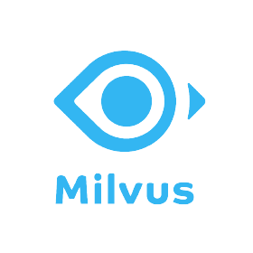
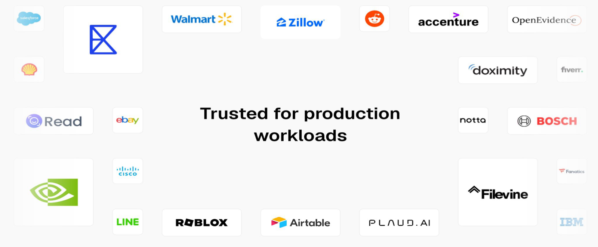
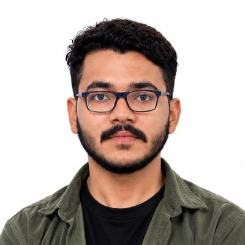

<!-- _class: lead -->

```episode
number: 002
date: November 2026
day: 17
youtube: Q46slutMeSA
special: gsoc2026 | GSoC 2026 Projects Showcase
```

---

```intro
```

---

```agenda
```

---

```speaker special
```

---

<!-- _class: sq sq-cover -->

<style>
/* cover */
section.sq-cover { justify-content: center; padding-top: 40px; }
section.sq-cover .cover { display: grid; grid-template-columns: 1.3fr 1fr; gap: 36px; align-items: center; }
section.sq-cover .thesis { display: flex; flex-direction: column; gap: 14px; }
section.sq-cover .term { border-radius: 14px; overflow: hidden; border: 1px solid var(--dbz-border-strong); background: var(--dbz-bg-deep); box-shadow: 0 24px 60px rgba(0, 0, 0, 0.5); }
section.sq-cover .term.ev { border-color: rgba(145, 212, 67, 0.55); box-shadow: 0 24px 60px rgba(0, 0, 0, 0.5), 0 0 50px rgba(145, 212, 67, 0.12); }
section.sq-cover .term .bar { display: flex; justify-content: space-between; padding: 9px 16px; font-family: 'JetBrains Mono', ui-monospace, monospace; font-size: 12px; letter-spacing: 0.12em; text-transform: uppercase; color: var(--dbz-muted); background: var(--dbz-surface-2); }
section.sq-cover .term pre { margin: 0; padding: 14px 18px; border: 0; border-radius: 0; background: transparent; font-family: 'JetBrains Mono', ui-monospace, monospace; font-size: 16px; line-height: 1.55; color: var(--dbz-text); white-space: pre; }
section.sq-cover .k { color: var(--dbz-accent-strong); } section.sq-cover .s { color: var(--dbz-warn); } section.sq-cover .n { color: #A98BF5; } section.sq-cover .g { color: var(--dbz-brand-strong); } section.sq-cover .m { color: var(--dbz-muted); }
section.sq-cover .arrow { align-self: center; font-family: 'JetBrains Mono', ui-monospace, monospace; font-size: 13px; letter-spacing: 0.12em; text-transform: uppercase; color: var(--dbz-muted); }

section.sq-cover h1 { margin: 0; font-size: 64px; line-height: 0.98; font-weight: 800; letter-spacing: -0.04em; }
section.sq-cover .people { display: flex; align-items: center; gap: 48px; margin-top: 56px; }
section.sq-cover .speaker { display: flex; align-items: center; gap: 22px; }
section.sq-cover .speaker img { width: 116px; height: 116px; border-radius: 50%; object-fit: cover; padding: 4px; background: linear-gradient(135deg, var(--dbz-brand), var(--dbz-accent)); }
section.sq-cover .who b { display: block; font-size: 32px; font-weight: 700; letter-spacing: -0.01em; color: var(--dbz-text); }
section.sq-cover .who span { display: block; margin-top: 4px; font-size: 19px; color: var(--dbz-muted); }
section.sq-cover .mentors { display: flex; flex-direction: column; gap: 14px; padding-left: 48px; border-left: 1px solid var(--dbz-border); }
section.sq-cover .mentor { display: flex; align-items: center; gap: 14px; font-size: 19px; color: var(--dbz-text); font-weight: 600; }
section.sq-cover .mentor img { width: 48px; height: 48px; border-radius: 50%; object-fit: cover; border: 1px solid var(--dbz-border-strong); }
section.sq-cover .mentor small { display: block; font-size: 15px; font-weight: 400; color: var(--dbz-muted); }

/* overrides (kept last so they win) */
section.sq-cover .people { margin-top: 40px; flex-direction: column; align-items: flex-start; gap: 28px; }
section.sq-cover .mentors { padding-left: 0; border-left: 0; flex-direction: row; flex-wrap: wrap; gap: 12px 32px; }
section.sq-cover .mentors .label { flex-basis: 100%; }
</style>

<div class="cover">
<div>
<div class="eyebrow">GSoC 2026</div>
<h1>Source connector<br>for <em>Milvus</em></h1>
<div class="people">
<div class="speaker"><div class="who"><b>Kartik Angiras</b><span>Speaker &amp; contributor · GSoC 2026</span></div></div>
<div class="mentors">
<div class="label">Mentored by</div>
<div class="mentor"><div>Chris Cranford<small>Senior Principal Software Engineer, IBM</small></div></div>
<div class="mentor"><div>Giovanni Panice<small>Senior Software Engineer, IBM</small></div></div>
</div>
</div>
</div>
<div class="thesis">
<div class="term"><div class="bar"><span>Milvus</span><span>Upsert</span></div><pre><span class="k">curl -X POST</span> milvus.debezium.io/v2/vectordb/entities/insert
<span class="k">-H 'Content-Type: application/json'</span>
<span class="k">-d</span> '{"collectionName": "products", 
"data": [{"pk": 1005, "name":"camping stove", 
"category": "outdoor", "price": 59.99, 
"embedding": [0.1, 0.3, 0.3, 0.5]}]}'</pre>
</div>
<div class="arrow">↓ debezium milvus connector</div>
<div class="term ev"><div class="bar"><span>topic · milvus.default.products</span><span>Event out</span></div><pre>{
  <span class="g">"op"</span>: <span class="s">"c"</span>,
  <span class="g">"before"</span>: <span class="m">null</span>,
  <span class="g">"after"</span>: { <span class="g">"pk"</span>: <span class="n">1005</span>, <span class="g">"price"</span>: <span class="s">"59.99"</span> },
  <span class="g">"source"</span>: { <span class="g">"connector"</span>: <span class="s">"milvus"</span>, <span class="g">"collection"</span>: <span class="s">"products"</span> }
}</pre></div>
</div>
</div>

---

<!-- _class: sq mv -->

<style>
/* Milvus connector slides. Builds on the shared section.sq layout of the SQLite slides; everything here is scoped to section.sq.mv. */
section.sq.mv { --mv-ins: 72, 191, 224; --mv-ups: 169, 139, 245; --mv-ok: 145, 212, 67; --mv-tso: 240, 168, 40; --mv-bad: 240, 122, 138; }
section.sq.mv .node { font-size: 17px; padding: 10px 14px; }
section.sq.mv .node.c-ins { border-color: rgba(var(--mv-ins), 0.6); background: rgba(var(--mv-ins), 0.10); }
section.sq.mv .node.c-ups { border-color: rgba(var(--mv-ups), 0.6); background: rgba(var(--mv-ups), 0.12); }
section.sq.mv .node.c-ok { border-color: rgba(var(--mv-ok), 0.6); background: rgba(var(--mv-ok), 0.10); }
section.sq.mv .node.c-tso { border-color: rgba(var(--mv-tso), 0.6); background: rgba(var(--mv-tso), 0.10); }
section.sq.mv .node.c-bad { border-color: rgba(var(--mv-bad), 0.6); background: rgba(var(--mv-bad), 0.12); }
section.sq.mv .node.c-grey { border-color: var(--dbz-border-strong); background: var(--dbz-surface-2); }
section.sq.mv .node.c-file { font-family: 'JetBrains Mono', ui-monospace, monospace; font-size: 15px; color: var(--sq-text); border-color: rgba(var(--mv-tso), 0.45); background: rgba(var(--mv-tso), 0.06); }
section.sq.mv .vedge { position: relative; height: 40px; }
section.sq.mv .vedge i { position: absolute; left: 50%; top: 3px; bottom: 7px; width: 2px; margin-left: -1px; background: var(--sq-line); }
section.sq.mv .vedge i::after { content: ''; position: absolute; bottom: -8px; left: -5px; border-top: 9px solid var(--sq-line); border-left: 6px solid transparent; border-right: 6px solid transparent; }
section.sq.mv .vedge span { position: absolute; left: calc(50% + 12px); top: 50%; transform: translateY(-55%); white-space: nowrap; font-family: 'JetBrains Mono', ui-monospace, monospace; font-size: 13px; color: var(--dbz-muted); }
section.sq.mv .tag { white-space: nowrap; padding: 4px 10px; border-radius: 999px; text-align: center; font-family: 'JetBrains Mono', ui-monospace, monospace; font-size: 13px; font-weight: 600; }
section.sq.mv .tag.ok { color: var(--dbz-brand-strong); border: 1px solid rgba(var(--mv-ok), 0.5); background: rgba(var(--mv-ok), 0.08); }
section.sq.mv .tag.no { color: var(--dbz-muted); border: 1px dashed var(--dbz-border-strong); }
section.sq.mv .doc { margin-top: 0; }

/* milvus logo (white tile, so it reads on the dark theme) */
section.sq img.mv-logo { display: block; width: 64px; height: 64px; margin: 0 auto 12px; border-radius: 16px; box-shadow: 0 12px 32px rgba(0, 0, 0, 0.45); }

/* what is milvus */
section.sq.mv .mv-ops { flex: 1; padding-right: 56px; display: grid; grid-template-columns: 110px repeat(3, 1fr); grid-template-rows: auto 52px auto auto; gap: 8px 18px; align-items: center; align-content: center; }
section.sq.mv .mv-ops > .label { font-size: 11px; }
section.sq.mv .mv-ops .node { text-align: center; }
section.sq.mv .mv-ops .vedge { height: 100%; }
section.sq.mv .mv-logflow { flex: 0 0 330px; display: flex; flex-direction: column; align-items: stretch; justify-content: center; gap: 0; padding: 18px 22px; border-radius: 16px; border: 1px dashed var(--dbz-border-strong); }
section.sq.mv .mv-logflow .node { text-align: center; }
section.sq.mv .mv-logflow .label { margin-bottom: 10px; text-align: center; font-size: 11px; }
section.sq.mv .mv-logflow .doc { margin-top: 18px; align-self: center; font-size: 14px; }

/* architecture */
section.sq.mv .mv-layers { flex: 0.85; min-width: 0; display: flex; flex-direction: column; gap: 14px; justify-content: center; }
section.sq.mv .layer { position: relative; padding: 24px 12px 10px; border-radius: 12px; border: 1px dashed var(--dbz-border-strong); }
section.sq.mv .layer > .label { position: absolute; top: 6px; left: 12px; font-size: 11px; }
section.sq.mv .layer + .layer::before { content: ''; position: absolute; top: -15px; left: 50%; width: 2px; height: 14px; background: var(--sq-line); }
section.sq.mv .layer .row { display: flex; gap: 10px; justify-content: center; }
section.sq.mv .layer .node { flex: 1; font-size: 16px; padding: 8px 10px; }
section.sq.mv .layer .node.solo { flex: 0 1 200px; }
section.sq.mv .mv-coll { flex: 1.05; min-width: 0; display: flex; flex-direction: column; justify-content: center; gap: 10px; }
section.sq.mv table.mv-tbl, section.sq.mv table.cmp { display: table; }
section.sq.mv table tr { background: transparent; }
section.sq.mv table.mv-tbl { width: 100%; border-collapse: separate; border-spacing: 0; font-family: 'JetBrains Mono', ui-monospace, monospace; font-size: 13.5px; }
section.sq.mv table.mv-tbl th { padding: 9px 10px; text-align: left; font-size: 13px; font-weight: 600; color: var(--dbz-accent-strong); background: var(--dbz-surface-2); border: 0; }
section.sq.mv table.mv-tbl td { padding: 8px 10px; color: var(--dbz-text); background: var(--dbz-surface); border: 0; border-top: 1px solid var(--dbz-border); white-space: nowrap; }
section.sq.mv table.mv-tbl thead th:first-child { border-top-left-radius: 12px; } section.sq.mv table.mv-tbl thead th:last-child { border-top-right-radius: 12px; }
section.sq.mv table.mv-tbl .vec { color: #C6B2FF; background: #1B1C33; }
section.sq.mv table.mv-tbl th.vec { background: #2A2648; }
section.sq.mv table.mv-tbl tfoot td { padding: 8px 0 0; background: transparent; border: 0; border-top: 2px solid var(--dbz-accent); text-align: center; font-size: 12px; letter-spacing: 0.12em; text-transform: uppercase; color: var(--dbz-accent-strong); }
section.sq.mv table.mv-tbl tfoot td.vec { border-top-color: #A98BF5; color: #C6B2FF; background: transparent; }

/* fan-out tweaks */
section.sq.mv .fan { grid-template-columns: 220px 1fr 230px 1fr 290px; grid-template-rows: auto 300px; }
section.sq.mv .fan .chip { padding: 8px 14px; font-size: 17px; }
section.sq.mv .fan .chip small { display: block; font-size: 13px; color: var(--dbz-muted); }
section.sq.mv .hub small + b + small { margin-top: 6px; font-size: 11px; color: var(--dbz-muted); }

/* data path */
section.sq.mv .mv-path { flex: 1; display: flex; flex-direction: column; justify-content: center; gap: 18px; }
section.sq.mv .node.read { color: var(--dbz-on-fill); background: linear-gradient(135deg, var(--dbz-brand), var(--dbz-accent)); border: 0; }
section.sq.mv .node.read small { color: rgba(7, 15, 22, 0.7); }
section.sq.mv .lane { position: relative; display: grid; grid-template-columns: 165px 1fr 165px 1fr 165px 1fr 165px; align-items: center; padding: 28px 16px 14px; border-radius: 14px; border: 1px dashed var(--dbz-border-strong); }
section.sq.mv .lane > .label { position: absolute; top: 7px; left: 16px; font-size: 11px; }
section.sq.mv .lane .edge { min-width: 0; padding: 0 10px; font-size: 12px; }
section.sq.mv .lane .node { padding: 10px 10px; font-size: 16px; }
section.sq.mv .lane .node small { font-size: 13px; }

/* ordering */
section.sq.mv .mv-order { flex: 1; display: flex; flex-direction: column; justify-content: center; gap: 22px; }
section.sq.mv .arrival { position: relative; padding: 28px 18px 16px; border-radius: 14px; border: 1px dashed var(--dbz-border-strong); }
section.sq.mv .arrival > .label { position: absolute; top: 7px; left: 18px; font-size: 11px; }
section.sq.mv .arrival .flow .node { flex: 1; }
section.sq.mv .arrival .flow .edge { flex: 0 0 34px; min-width: 34px; }
section.sq.mv .outcomes { display: grid; grid-template-columns: 1.7fr 1fr 1fr; gap: 16px; }
section.sq.mv .card { display: flex; flex-direction: column; gap: 10px; padding: 16px 18px; border-radius: 14px; background: var(--dbz-surface); border: 1px solid var(--dbz-border); }
section.sq.mv .card.ok { border-color: rgba(var(--mv-ok), 0.55); box-shadow: 0 0 40px rgba(var(--mv-ok), 0.07); }
section.sq.mv .card.bad { border-color: rgba(var(--mv-bad), 0.55); }
section.sq.mv .card .label { font-size: 12px; }
section.sq.mv .card.ok .label { color: var(--dbz-brand-strong); } section.sq.mv .card.bad .label { color: var(--sq-blob); }
section.sq.mv .card b { font-size: 20px; line-height: 1.25; color: var(--dbz-text); }
section.sq.mv .card p { margin: 0; font-size: 16px; line-height: 1.45; color: var(--dbz-muted); }
section.sq.mv .card .flow .node { flex: 1; font-size: 15px; padding: 8px 10px; }
section.sq.mv .card .flow .edge { flex: 0 0 26px; min-width: 26px; }
section.sq.mv .verdict { display: inline-flex; align-self: flex-start; align-items: center; gap: 8px; padding: 5px 12px; border-radius: 8px; font-size: 16px; font-weight: 700; }
section.sq.mv .verdict.ok { color: var(--dbz-on-fill); background: var(--dbz-brand); }
section.sq.mv .verdict.bad { color: var(--dbz-on-fill); background: var(--sq-blob); }

/* upsert */
section.sq.mv .mv-seq { flex: 1.25; min-width: 0; display: flex; flex-direction: column; gap: 14px; justify-content: center; }
section.sq.mv .mv-seq .flow .node { flex: 1; }
section.sq.mv .mv-seq .flow .edge { flex: 0 0 auto; min-width: 70px; }
section.sq.mv .alt { display: grid; grid-template-columns: 1fr 1fr; gap: 14px; }
section.sq.mv .evs { display: flex; flex-direction: column; gap: 6px; }
section.sq.mv .ev { display: flex; align-items: center; gap: 10px; padding: 6px 10px; border-radius: 8px; font-family: 'JetBrains Mono', ui-monospace, monospace; font-size: 15px; color: var(--dbz-text); background: var(--dbz-surface-2); }
section.sq.mv .ev .op { width: 26px; }
section.sq.mv .op.t { background: var(--sq-null); }
section.sq.mv .mv-cmp { flex: 1; min-width: 0; display: flex; flex-direction: column; justify-content: center; gap: 10px; }
section.sq.mv table.cmp { width: 100%; border-collapse: separate; border-spacing: 0; font-size: 17px; }
section.sq.mv table.cmp th { padding: 10px 14px; text-align: left; font-size: 14px; font-weight: 600; letter-spacing: 0.04em; color: var(--dbz-muted); background: var(--dbz-surface-2); border: 0; }
section.sq.mv table.cmp th.m { color: var(--dbz-accent-strong); }
section.sq.mv table.cmp td { padding: 10px 14px; color: var(--dbz-text); background: var(--dbz-surface); border: 0; border-top: 1px solid var(--dbz-border); }
section.sq.mv table.cmp td.m { font-family: 'JetBrains Mono', ui-monospace, monospace; font-size: 15px; color: #FFC2CB; background: #1E1825; }
section.sq.mv table.cmp thead th:first-child { border-top-left-radius: 12px; } section.sq.mv table.cmp thead th:last-child { border-top-right-radius: 12px; }

/* why */
section.sq.mv .mv-why { flex: 1.15; min-width: 0; display: flex; flex-direction: column; justify-content: center; align-items: stretch; }
section.sq.mv .mv-why .root { align-self: center; }
section.sq.mv .opts { display: grid; grid-template-columns: repeat(4, 1fr); gap: 6px 12px; }
section.sq.mv .opts .node { text-align: center; font-size: 15px; padding: 8px 6px; }
section.sq.mv .opts .vedge { height: 26px; }
section.sq.mv .merge { height: 18px; margin: 4px 12.5% 0; border: 2px solid var(--sq-line); border-top: 0; border-radius: 0 0 10px 10px; }
section.sq.mv .merge + .vedge { height: 22px; }
section.sq.mv .fan-in { height: 26px; margin: 0 12.5% 4px; border: 2px solid var(--sq-line); border-bottom: 0; border-radius: 10px 10px 0 0; position: relative; }
section.sq.mv .fan-in::before { content: ''; position: absolute; left: 50%; top: -18px; width: 2px; height: 16px; background: var(--sq-line); }
section.sq.mv .mv-why .stackc { display: flex; flex-direction: column; align-items: center; }
section.sq.mv .mv-why .stackc .node { min-width: 280px; }
section.sq.mv .adopt { flex: 1; min-width: 0; display: flex; flex-direction: column; justify-content: center; gap: 10px; }
section.sq.mv .adopt img { width: 100%; border-radius: 14px; border: 1px solid var(--dbz-border-strong); }
section.sq.mv .adopt .src { margin-top: 0; font-size: 14px; }

/* what's next */
section.sq.mv .why25 { display: flex; align-items: center; gap: 12px; margin-bottom: 34px; }
section.sq.mv .why25 .node { font-size: 16px; }
section.sq.mv .why25 .edge { min-width: 110px; }
section.sq.mv .why25 .because { display: flex; gap: 8px; flex-wrap: wrap; margin-left: 8px; }
section.sq.mv .why25 .because span { padding: 4px 12px; border-radius: 999px; font-size: 15px; color: var(--dbz-muted); border: 1px solid var(--dbz-border-strong); }
section.sq.mv .road { grid-template-columns: repeat(3, 1fr); }
section.sq.mv .cta { margin-top: 44px; }
</style>

## Milvus is an open-source *vector database*

<p class="lede">A collection stores entities: scalar fields plus an <b>embedding vector</b>. Every write is recorded in a log and stamped with a timestamp from the <b>TSO</b>, the timestamp oracle.</p>

<div class="body">
<div class="mv-ops">
<div class="label">Operation</div>
<div class="node c-ins">insert</div>
<div class="node c-ups">upsert</div>
<div class="node c-grey">search</div>
<div></div>
<div class="vedge"><i></i><span>vector + fields</span></div>
<div class="vedge"><i></i><span>same pk, new vector</span></div>
<div class="vedge"><i></i><span>top k by similarity</span></div>
<div class="label">Collection change</div>
<div class="node c-ins">New vector entity</div>
<div class="node c-ups">Delete plus insert</div>
<div class="node c-grey">No change</div>
<div></div>
<div class="tag ok">recorded in the log</div>
<div class="tag ok">recorded in the log</div>
<div class="tag no">nothing recorded</div>
</div>
<div class="mv-logflow">

<div class="label">Inside Milvus</div>
<div class="node c-tso">TSO</div>
<div class="vedge"><i></i><span>stamps entries</span></div>
<div class="node c-ok">Log</div>
<div class="vedge"><i></i><span>streamed to</span></div>
<div class="node read">CDC reader</div>
<a class="doc" href="https://github.com/debezium/debezium-design-documents/pull/48">Design document · debezium-design-documents#48 ↗</a>
</div>
</div>

---

<!-- _class: sq mv -->

## Inside Milvus: a *distributed* vector database

<p class="lede">Proxies, coordinators and worker nodes sit on shared storage. The <b>log broker</b> carries every write, and that is where change data capture starts.</p>

<div class="body">
<div class="mv-layers">
<div class="layer"><div class="label">Access layer</div><div class="row"><div class="node c-grey solo">Proxies</div></div></div>
<div class="layer"><div class="label">Coordinators</div><div class="row"><div class="node c-ups">Root coord</div><div class="node c-ups">Data coord</div><div class="node c-ups">Query coord</div></div></div>
<div class="layer"><div class="label">Worker nodes</div><div class="row"><div class="node c-ins">Query node</div><div class="node c-ins">Data node</div><div class="node c-ins">Index node</div></div></div>
<div class="layer"><div class="label">Storage</div><div class="row"><div class="node c-tso">etcd</div><div class="node c-tso">MinIO or S3</div><div class="node c-ok">Log broker</div></div></div>
</div>
<div class="mv-coll">
<div class="label">products collection</div>
<table class="mv-tbl">
<thead><tr><th>pk</th><th>name</th><th>category</th><th>price</th><th class="vec">embedding</th></tr></thead>
<tbody>
<tr><td>1001</td><td>trail running shoes</td><td>outdoor</td><td>89.99</td><td class="vec">[0.1, 0.2, 0.3, 0.4]</td></tr>
<tr><td>1002</td><td>cast iron skillet</td><td>kitchen</td><td>34.50</td><td class="vec">[0.9, 0.1, 0.2, 0.3]</td></tr>
<tr><td>1003</td><td>wireless headphones</td><td>electronics</td><td>129.00</td><td class="vec">[0.2, 0.8, 0.1, 0.5]</td></tr>
<tr><td>1004</td><td>building blocks</td><td>toys</td><td>24.99</td><td class="vec">[0.4, 0.4, 0.9, 0.1]</td></tr>
</tbody>
<tfoot><tr><td colspan="4">scalar fields</td><td class="vec">vector field</td></tr></tfoot>
</table>
</div>
</div>

---

<!-- _class: sq mv -->

## Every collection, *streamed* to any sink

<p class="lede">The connector reads the <b>pchannels</b> Milvus already writes and emits one topic per collection, so each downstream system gets the same ordered changes.</p>

<div class="body">
<div class="fan">
<div class="label" style="grid-column:1;">Why capture changes</div><div class="label" style="grid-column:5;">Sinks</div>
<div class="chips"><div class="chip">Hybrid search</div><div class="chip">Vectors plus SQL</div><div class="chip">RAG freshness</div><div class="chip">Right to erasure</div><div class="chip">Model rollout</div></div>
<svg viewBox="0 0 100 300" preserveAspectRatio="none"><line x1="0" y1="30" x2="100" y2="150"/><line x1="0" y1="90" x2="100" y2="150"/><line x1="0" y1="150" x2="100" y2="150"/><line x1="0" y1="210" x2="100" y2="150"/><line x1="0" y1="270" x2="100" y2="150"/></svg>
<div class="hub"><div><small>Debezium</small><b>Milvus source</b><small>reads pchannels · topic per collection</small></div></div>
<svg class="out" viewBox="0 0 100 300" preserveAspectRatio="none"><line x1="0" y1="150" x2="100" y2="38"/><line x1="0" y1="150" x2="100" y2="113"/><line x1="0" y1="150" x2="100" y2="188"/><line x1="0" y1="150" x2="100" y2="263"/></svg>
<div class="chips out"><div class="chip">Elasticsearch<small>keyword + vector search</small></div><div class="chip">Postgres pgvector<small>join vectors with SQL</small></div><div class="chip">Redis<small>cache fresh RAG results</small></div><div class="chip">S3<small>audit log of deletes</small></div></div>
</div>
</div>

---

<!-- _class: sq mv -->

## How a write *travels* through Milvus

<p class="lede">Each shard of a collection is a virtual channel (vchannel) carried on a physical channel (<b>pchannel</b>). The connector reads the pchannel, before writes are split into segments.</p>

<div class="body">
<div class="mv-path">
<div class="flow">
<div class="node c-ins">products collection</div>
<div class="edge">shard 0<i></i></div>
<div class="node c-ups">vchannel</div>
<div class="edge">carried on<i></i></div>
<div class="node read">pchannel<small>read by Debezium</small></div>
</div>
<div class="lane"><span class="label">inserts</span>
<div class="node c-tso">Growing segment<small>per partition</small></div>
<div class="edge">size or idle limit<i></i></div>
<div class="node c-tso">Sealed segment</div>
<div class="edge">flushed<i></i></div>
<div class="node c-file">Field binlogs<small>and stats</small></div>
<div class="edge">index node, later<i></i></div>
<div class="node c-file">Index files</div>
</div>
<div class="lane"><span class="label">deletes</span>
<div class="node c-tso">L0 segment</div>
<div class="edge">flushed<i></i></div>
<div class="node c-file">Delta logs</div>
</div>
</div>
</div>

---

<!-- _class: sq mv -->

## Arrival order is *not* commit order

<p class="lede">Proxies stamp each write with a TSO, but writes reach the pchannel in any order. A <b>TimeTick</b> promises that everything up to its timestamp has arrived.</p>

<div class="body">
<div class="mv-order">
<div class="arrival"><span class="label">Arrival order on one pchannel · collection products</span>
<div class="flow">
<div class="node c-ups">delete pk 7<small>TSO 105 · via proxy 2</small></div>
<div class="edge"><i></i></div>
<div class="node c-ins">insert pk 7<small>TSO 101 · via proxy 1</small></div>
<div class="edge"><i></i></div>
<div class="node c-ins">insert pk 9<small>TSO 112</small></div>
<div class="edge"><i></i></div>
<div class="node c-tso">TimeTick 110</div>
</div>
</div>
<div class="outcomes">
<div class="card ok">
<div class="label">Debezium · emitted in TSO order, up to 110</div>
<div class="flow"><div class="node c-ok">insert pk 7 @ 101</div><div class="edge"><i></i></div><div class="node c-ok">delete pk 7 @ 105</div></div>
<div class="verdict ok">✓ pk 7 deleted</div>
</div>
<div class="card">
<div class="label">Above 110</div>
<b>insert pk 9 @ 112</b>
<p>Held until the next TimeTick says it is safe to emit.</p>
</div>
<div class="card bad">
<div class="label">Naive sink · arrival order</div>
<b>Delete, then insert</b>
<div class="verdict bad">✕ pk 7 comes back</div>
</div>
</div>
</div>
</div>

---

<!-- _class: sq mv -->

## An upsert is a delete *plus* an insert

<p class="lede">Both halves share one TSO, so their order has to come from the log. And in Milvus 2.5 that log is an <b>internal queue</b>, not a public API.</p>

<div class="body">
<div class="mv-seq">
<div class="flow">
<div class="node c-grey">App</div>
<div class="edge">upsert 1005<i></i></div>
<div class="node c-ins">Milvus</div>
<div class="edge">same TSO t<i></i></div>
<div class="node c-ok">pchannel<small>delete + insert</small></div>
</div>
<div class="alt">
<div class="card ok">
<div class="label">Log order kept</div>
<div class="evs"><div class="ev"><span class="op d">d</span>key only</div><div class="ev"><span class="op t">t</span>tombstone</div><div class="ev"><span class="op c">c</span>full row</div></div>
<div class="verdict ok">✓ 1005 exists</div>
</div>
<div class="card bad">
<div class="label">Insert emitted first</div>
<div class="evs"><div class="ev"><span class="op c">c</span>full row</div><div class="ev"><span class="op d">d</span>key only</div><div class="ev"><span class="op t">t</span>tombstone</div></div>
<div class="verdict bad">✕ 1005 deleted</div>
</div>
</div>
</div>
<div class="mv-cmp">
<div class="label">Reading the log</div>
<table class="cmp">
<thead><tr><th>Typical database</th><th class="m">Milvus 2.5</th></tr></thead>
<tbody>
<tr><td>Log for readers</td><td class="m">Internal queue</td></tr>
<tr><td>Documented interface</td><td class="m">Internal protos</td></tr>
<tr><td>One log position</td><td class="m">Offset plus etcd key</td></tr>
<tr><td>The database itself</td><td class="m">Kafka, etcd, gRPC, MinIO</td></tr>
</tbody>
</table>
</div>
</div>

---

<!-- _class: sq mv -->

## Every workaround *loses* changes

<p class="lede">When an entity changes, teams pick one of four options today, and each one breaks a downstream copy. One ordered stream fixes all four.</p>

<div class="body">
<div class="mv-why">
<div class="stackc"><div class="node c-ins">An entity changes</div></div>
<div class="fan-in"></div>
<div class="opts">
<div class="node c-grey">Dual writes</div><div class="node c-grey">Batch export</div><div class="node c-grey">milvus-cdc</div><div class="node c-grey">Nothing</div>
<div class="vedge"><i></i></div><div class="vedge"><i></i></div><div class="vedge"><i></i></div><div class="vedge"><i></i></div>
<div class="node c-bad">Divergent copies</div><div class="node c-bad">Deletes invisible</div><div class="node c-bad">Milvus targets only</div><div class="node c-bad">Ghost entities</div>
</div>
<div class="merge"></div>
<div class="stackc">
<div class="vedge"><i></i></div>
<div class="node c-ups">Open community requests</div>
<div class="vedge"><i></i><span>one ordered stream</span></div>
<div class="node read">Debezium Milvus source</div>
</div>
</div>
<div class="adopt">
<div class="label">Milvus in production</div>

<div class="src">Source: milvus.io</div>
</div>
</div>

---

<!-- _class: sq sq-demo -->

## Pipeline demo: *Milvus to pgvector*

<div class="body">
<div class="player">
<div class="bar"><i></i><i></i><i></i><span>demo · milvus connector</span></div>
<div class="screen"><iframe src="https://drive.google.com/file/d/1zH1dpBRTu80YBP2jGSFDGmTVYq2ZaIiQ/preview" title="Milvus connector demo: inserts, upserts and deletes in Milvus streamed to pgvector" allow="autoplay; fullscreen" allowfullscreen></iframe></div>
</div>
</div>

---

<!-- _class: sq mv -->

## What's next for the *Milvus connector*

<div class="body" style="flex-direction:column;justify-content:center;gap:0;">
<div class="why25">
<div class="node c-ok">Milvus 2.5<small>log on Kafka</small></div>
<div class="edge">the only change<i></i></div>
<div class="node c-ups">Milvus 2.6<small>log on Woodpecker</small></div>
<div class="because"><span>2.6 WAL protos still changing</span><span>milvus-cdc reads the 2.5 queue</span><span>Most deployments run 2.5</span></div>
</div>
<div class="road">
<div class="mile now"><div class="pin"></div><div class="label">Today</div><b>Built against Milvus 2.5</b><p>Reads the log that Milvus 2.5 keeps on Kafka.</p></div>
<div class="mile"><div class="pin"></div><div class="label">Next</div><b>A Woodpecker consumer for Milvus 2.6</b><p>Read the same log from Woodpecker, the new log store in 2.6.</p></div>
<div class="mile"><div class="pin"></div><div class="label">Try it</div><b>milvus-to-pgvector example</b><p>A runnable Milvus to pgvector pipeline: <a href="https://github.com/debezium/debezium-examples/tree/main/milvus-to-pgvector">debezium-examples/milvus-to-pgvector ↗</a></p></div>
</div>
<div class="cta">Questions or want to contribute? Join the Milvus channel <span>debezium.zulipchat.com</span></div>
</div>

---

<!-- _class: sq sq-cover -->

<style>
/* SQLite connector slides. Layout: eyebrow + display headline + lede, then one native visual that fills the rest. */
section.sq {
  --sq-line: #3A5B66; --sq-int: #48BFE0; --sq-real: #A98BF5; --sq-text: #F0A828; --sq-blob: #F07A8A; --sq-null: #8296A3;
  --sq-ready: #F07A8A; --sq-set: #F0A828; --sq-go: #91D443;
  display: flex; flex-direction: column; justify-content: flex-start; padding: 58px 72px 66px;
}
section.sq .eyebrow { display: flex; align-items: center; gap: 12px; margin: 0 0 14px; font-family: 'JetBrains Mono', ui-monospace, monospace; font-size: 15px; font-weight: 600; letter-spacing: 0.16em; text-transform: uppercase; color: var(--dbz-accent-strong); }
section.sq .eyebrow { gap: 0; color: rgba(164, 181, 193, 0.55); }
section.sq .eyebrow span { display: flex; align-items: center; gap: 10px; }
section.sq .eyebrow span + span::before { order: -2; content: ''; width: 26px; height: 1px; margin: 0 14px 0 4px; background: var(--dbz-border-strong); }
section.sq .eyebrow span.on { color: var(--dbz-accent-strong); }
section.sq .eyebrow span.on::after { content: ''; order: -1; width: 10px; height: 10px; border-radius: 2px; background: linear-gradient(135deg, var(--dbz-brand), var(--dbz-accent)); }
section.sq-cover .eyebrow::before { content: ''; width: 10px; height: 10px; margin-right: 12px; border-radius: 2px; background: linear-gradient(135deg, var(--dbz-brand), var(--dbz-accent)); }
section.sq-cover .eyebrow { color: var(--dbz-accent-strong); }
section.sq h2 { margin: 0; padding: 0; border: 0; max-width: 960px; font-size: 46px; line-height: 1.08; font-weight: 800; letter-spacing: -0.025em; color: var(--dbz-text); text-wrap: balance; }
section.sq h2 em, section.sq h1 em { font-style: normal; color: transparent; background: linear-gradient(90deg, var(--dbz-brand), var(--dbz-accent)); -webkit-background-clip: text; background-clip: text; }
section.sq .lede { margin: 14px 0 0; max-width: 64ch; font-size: 22px; line-height: 1.45; color: var(--dbz-muted); }
section.sq .lede b { color: var(--dbz-text); font-weight: 600; }
section.sq .lede code, section.sq td code { font-size: 0.86em; }
section.sq .body { flex: 1; min-height: 0; margin-top: 30px; display: flex; gap: 32px; }
section.sq .mono { font-family: 'JetBrains Mono', ui-monospace, monospace; }
section.sq .label { font-family: 'JetBrains Mono', ui-monospace, monospace; font-size: 13px; font-weight: 600; letter-spacing: 0.14em; text-transform: uppercase; color: var(--dbz-muted); }

/* cover */
section.sq-cover { justify-content: center; padding-top: 40px; }
section.sq-cover .cover { display: grid; grid-template-columns: 1.3fr 1fr; gap: 36px; align-items: center; }
section.sq-cover .thesis { display: flex; flex-direction: column; gap: 14px; }
section.sq-cover .term { border-radius: 14px; overflow: hidden; border: 1px solid var(--dbz-border-strong); background: var(--dbz-bg-deep); box-shadow: 0 24px 60px rgba(0, 0, 0, 0.5); }
section.sq-cover .term.ev { border-color: rgba(145, 212, 67, 0.55); box-shadow: 0 24px 60px rgba(0, 0, 0, 0.5), 0 0 50px rgba(145, 212, 67, 0.12); }
section.sq-cover .term .bar { display: flex; justify-content: space-between; padding: 9px 16px; font-family: 'JetBrains Mono', ui-monospace, monospace; font-size: 12px; letter-spacing: 0.12em; text-transform: uppercase; color: var(--dbz-muted); background: var(--dbz-surface-2); }
section.sq-cover .term pre { margin: 0; padding: 14px 18px; border: 0; border-radius: 0; background: transparent; font-family: 'JetBrains Mono', ui-monospace, monospace; font-size: 16px; line-height: 1.55; color: var(--dbz-text); white-space: pre; }
section.sq-cover .k { color: var(--dbz-accent-strong); } section.sq-cover .s { color: var(--dbz-warn); } section.sq-cover .n { color: #A98BF5; } section.sq-cover .g { color: var(--dbz-brand-strong); } section.sq-cover .m { color: var(--dbz-muted); }
section.sq-cover .arrow { align-self: center; font-family: 'JetBrains Mono', ui-monospace, monospace; font-size: 13px; letter-spacing: 0.12em; text-transform: uppercase; color: var(--dbz-muted); }

section.sq-cover h1 { margin: 0; font-size: 64px; line-height: 0.98; font-weight: 800; letter-spacing: -0.04em; }
section.sq-cover .people { display: flex; align-items: center; gap: 48px; margin-top: 56px; }
section.sq-cover .speaker { display: flex; align-items: center; gap: 22px; }
section.sq-cover .speaker img { width: 116px; height: 116px; border-radius: 50%; object-fit: cover; padding: 4px; background: linear-gradient(135deg, var(--dbz-brand), var(--dbz-accent)); }
section.sq-cover .who b { display: block; font-size: 32px; font-weight: 700; letter-spacing: -0.01em; color: var(--dbz-text); }
section.sq-cover .who span { display: block; margin-top: 4px; font-size: 19px; color: var(--dbz-muted); }
section.sq-cover .mentors { display: flex; flex-direction: column; gap: 14px; padding-left: 48px; border-left: 1px solid var(--dbz-border); }
section.sq-cover .mentor { display: flex; align-items: center; gap: 14px; font-size: 19px; color: var(--dbz-text); font-weight: 600; }
section.sq-cover .mentor img { width: 48px; height: 48px; border-radius: 50%; object-fit: cover; border: 1px solid var(--dbz-border-strong); }
section.sq-cover .mentor small { display: block; font-size: 15px; font-weight: 400; color: var(--dbz-muted); }

/* stat hero */
section.sq .hero { flex: 1.15; display: flex; flex-direction: column; justify-content: center; min-width: 0; }
section.sq .big { font-size: 96px; line-height: 0.95; font-weight: 800; letter-spacing: -0.045em; color: transparent; background: linear-gradient(90deg, var(--dbz-brand), var(--dbz-accent)); -webkit-background-clip: text; background-clip: text; }
section.sq .big-cap { margin-top: 10px; font-size: 22px; font-weight: 600; color: var(--dbz-text); }
section.sq .facts { display: grid; grid-template-columns: 1fr 1fr; gap: 24px; margin-top: 30px; padding-top: 22px; border-top: 1px solid var(--dbz-border); font-size: 18px; line-height: 1.4; color: var(--dbz-muted); }
section.sq .facts b { display: block; margin-bottom: 4px; font-size: 19px; color: var(--dbz-text); }
section.sq .src { margin-top: 22px; font-size: 15px; color: var(--dbz-muted); }
section.sq .meme { flex: 1; min-width: 0; display: flex; align-items: center; justify-content: center; }
section.sq .meme img { max-width: 100%; max-height: 100%; border-radius: 16px; border: 1px solid var(--dbz-border-strong); box-shadow: 0 18px 50px rgba(0, 0, 0, 0.45); }

/* fan-out */
section.sq .fan { flex: 1; display: grid; grid-template-columns: 300px 1fr 240px 1fr 250px; grid-template-rows: auto 280px; column-gap: 0; row-gap: 14px; align-self: center; }
section.sq .fan .label { grid-row: 1; }
section.sq .fan .chips { grid-row: 2; display: flex; flex-direction: column; justify-content: space-around; }
section.sq .chip { padding: 12px 16px; border-radius: 10px; font-size: 18px; font-weight: 500; color: var(--dbz-text); background: var(--dbz-surface); border: 1px solid var(--dbz-border); }
section.sq .chips.out .chip { border-color: rgba(145, 212, 67, 0.45); background: rgba(145, 212, 67, 0.07); }
section.sq .fan svg { grid-row: 2; width: 100%; height: 100%; overflow: visible; }
section.sq .fan line { stroke: var(--sq-line); stroke-width: 2; vector-effect: non-scaling-stroke; }
section.sq .fan svg.out line { stroke: var(--dbz-brand); stroke-opacity: 0.7; }
section.sq .hub { grid-row: 2; align-self: center; padding: 3px; border-radius: 16px; background: linear-gradient(135deg, var(--dbz-brand), var(--dbz-accent)); box-shadow: 0 0 40px rgba(72, 191, 224, 0.25); }
section.sq .hub div { padding: 18px 18px; border-radius: 13px; background: var(--dbz-bg); text-align: center; }
section.sq .hub small { display: block; font-family: 'JetBrains Mono', ui-monospace, monospace; font-size: 13px; letter-spacing: 0.14em; text-transform: uppercase; color: var(--dbz-accent-strong); }
section.sq .hub b { display: block; margin-top: 4px; font-size: 22px; color: var(--dbz-text); }

/* design tree */
section.sq .tree { flex: 1.05; min-width: 0; display: flex; flex-direction: column; align-items: center; }
section.sq .tree .root { padding: 10px 26px; border-radius: 999px; font-weight: 700; font-size: 20px; color: var(--dbz-on-fill); background: var(--dbz-accent); }
section.sq .branches { position: relative; display: grid; grid-template-columns: 1fr 1fr; gap: 28px; width: 100%; margin-top: 30px; }
section.sq .branches::before { content: ''; position: absolute; top: -16px; left: 25%; right: 25%; height: 16px; border: 2px solid var(--sq-line); border-bottom: 0; border-radius: 10px 10px 0 0; }
section.sq .branches::after { content: ''; position: absolute; top: -30px; left: 50%; width: 2px; height: 14px; background: var(--sq-line); }
section.sq .branch { display: flex; flex-direction: column; gap: 10px; }
section.sq .branch .bh { margin-bottom: 4px; text-align: center; font-size: 19px; font-weight: 700; color: var(--dbz-text); }
section.sq .opt { display: flex; justify-content: space-between; align-items: center; padding: 11px 16px; border-radius: 10px; font-size: 18px; color: var(--dbz-muted); border: 1px dashed var(--dbz-border-strong); }
section.sq .opt.win { color: var(--dbz-text); font-weight: 600; border: 1px solid var(--dbz-brand); background: rgba(145, 212, 67, 0.1); }
section.sq .opt.win span { font-family: 'JetBrains Mono', ui-monospace, monospace; font-size: 13px; font-weight: 700; padding: 2px 8px; border-radius: 6px; color: var(--dbz-on-fill); background: var(--dbz-brand); }
section.sq .grave { flex: 1.25; min-width: 0; display: flex; flex-direction: column; gap: 12px; }
section.sq .grave .frame-img { flex: 1; min-height: 0; display: flex; align-items: center; justify-content: center; padding: 14px; border-radius: 14px; background: var(--dbz-bg-deep); border: 1px solid var(--dbz-border); }
section.sq .grave img { max-width: 100%; max-height: 100%; opacity: 0.9; filter: saturate(0.85); }
section.sq .stones { flex: 1; display: grid; grid-template-columns: repeat(3, 1fr); gap: 14px; align-items: end; }
section.sq .stone { display: flex; flex-direction: column; align-items: center; gap: 8px; height: 100%; max-height: 300px; padding: 30px 14px 18px; text-align: center; border-radius: 90px 90px 10px 10px; background: linear-gradient(180deg, #1F3140, var(--dbz-surface)); border: 1px solid var(--dbz-border-strong); box-shadow: inset 0 2px 0 rgba(255, 255, 255, 0.05), 0 14px 0 -6px var(--dbz-bg-deep); }
section.sq .stone:nth-child(2) { max-height: 330px; }
section.sq .stone small { font-family: 'JetBrains Mono', ui-monospace, monospace; font-size: 14px; font-weight: 700; letter-spacing: 0.3em; color: var(--dbz-muted); }
section.sq .stone b { font-size: 19px; line-height: 1.2; color: var(--dbz-text); }
section.sq .stone p { margin: 0; font-size: 14px; line-height: 1.45; color: var(--dbz-muted); }
section.sq .stone code { font-size: 12px; overflow-wrap: anywhere; }

/* capture flow + log table */
section.sq .stack { flex: 1; min-width: 0; display: flex; flex-direction: column; gap: 26px; }
section.sq .flow { display: flex; align-items: center; gap: 10px; }
section.sq .node { flex-shrink: 0; padding: 13px 16px; border-radius: 10px; text-align: center; font-size: 19px; font-weight: 600; line-height: 1.25; color: var(--dbz-text); background: var(--dbz-surface-2); border: 1px solid var(--dbz-border-strong); }
section.sq .node small { display: block; font-size: 14px; font-weight: 400; color: var(--dbz-muted); }
section.sq .node.log { font-family: 'JetBrains Mono', ui-monospace, monospace; font-size: 16px; color: var(--sq-text); border-color: rgba(240, 168, 40, 0.6); background: rgba(240, 168, 40, 0.08); }
section.sq .node.conn { color: var(--dbz-on-fill); background: linear-gradient(135deg, var(--dbz-brand), var(--dbz-accent)); border: 0; }
section.sq .node.conn small { color: rgba(7, 15, 22, 0.7); }
section.sq .db { position: relative; display: flex; align-items: center; gap: 10px; padding: 26px 14px 14px; border-radius: 14px; border: 1px dashed var(--dbz-border-strong); }
section.sq .db .label { position: absolute; top: 7px; left: 14px; font-size: 11px; }
section.sq .edge { flex: 1; min-width: 56px; display: flex; flex-direction: column; align-items: center; gap: 5px; font-family: 'JetBrains Mono', ui-monospace, monospace; font-size: 12px; color: var(--dbz-muted); white-space: nowrap; font-size: 13px; }
section.sq .edge i { position: relative; display: block; width: 100%; height: 2px; background: var(--sq-line); }
section.sq .edge i::after { content: ''; position: absolute; right: -1px; top: -5px; border-left: 9px solid var(--sq-line); border-top: 6px solid transparent; border-bottom: 6px solid transparent; }
section.sq table.log { width: 100%; border-collapse: separate; border-spacing: 0; font-family: 'JetBrains Mono', ui-monospace, monospace; font-size: 15px; border: 1px solid var(--dbz-border); border-radius: 12px; overflow: hidden; }
section.sq table.log th { padding: 10px 14px; text-align: left; font-size: 13px; font-weight: 600; color: var(--sq-text); background: var(--dbz-surface-2); border: 0; }
section.sq table.log td { padding: 9px 14px; color: var(--dbz-text); background: var(--dbz-surface); border: 0; border-top: 1px solid var(--dbz-border); }
section.sq table.log td.nil { color: var(--sq-null); font-style: italic; }
section.sq .op { display: inline-block; width: 24px; text-align: center; border-radius: 5px; font-weight: 700; color: var(--dbz-on-fill); }
section.sq .op.c { background: var(--dbz-brand); } section.sq .op.u { background: var(--dbz-warn); } section.sq .op.d { background: var(--sq-blob); }

/* pipeline */

/* type affinity */
section.sq .affwrap { flex: 1.35; min-width: 0; display: flex; flex-direction: column; gap: 12px; }
section.sq table.aff { width: 100%; border-collapse: separate; border-spacing: 0; font-size: 18px; border: 1px solid var(--dbz-border); border-radius: 12px; overflow: hidden; }
section.sq table.aff caption { caption-side: top; padding: 0 0 10px; text-align: left; }
section.sq table.aff th { padding: 10px 18px; text-align: left; font-size: 14px; font-weight: 600; letter-spacing: 0.04em; color: var(--dbz-muted); background: var(--dbz-surface-2); border: 0; }
section.sq table.aff td { padding: 9px 18px; font-family: 'JetBrains Mono', ui-monospace, monospace; color: var(--dbz-text); background: var(--dbz-surface); border: 0; border-top: 1px solid var(--dbz-border); }
section.sq .sc { display: inline-block; min-width: 92px; padding: 3px 10px; border-radius: 6px; text-align: center; font-family: 'JetBrains Mono', ui-monospace, monospace; font-size: 14px; font-weight: 700; color: var(--dbz-on-fill); }
section.sq .sc.int { background: var(--sq-int); } section.sq .sc.real { background: var(--sq-real); } section.sq .sc.text { background: var(--sq-text); } section.sq .sc.blob { background: var(--sq-blob); } section.sq .sc.null { background: var(--sq-null); }
section.sq .classes { flex: 1; min-width: 0; display: flex; flex-direction: column; gap: 14px; }
section.sq .classes .row { display: flex; flex-wrap: wrap; gap: 8px; }
section.sq .classes p { margin: 8px 0 0; font-size: 19px; line-height: 1.5; color: var(--dbz-muted); }
section.sq .classes p b { color: var(--dbz-text); }

/* roadmap */
section.sq .road { position: relative; display: grid; grid-template-columns: repeat(4, 1fr); gap: 28px; align-content: start; padding-top: 6px; }
section.sq .road::before { content: ''; position: absolute; top: 20px; left: 10px; right: -20px; height: 2px; background: linear-gradient(90deg, var(--dbz-brand), var(--sq-line) 30%); }
section.sq .road::after { content: ''; position: absolute; top: 15px; right: -24px; border-left: 11px solid var(--sq-line); border-top: 6px solid transparent; border-bottom: 6px solid transparent; }
section.sq .mile { position: relative; display: flex; flex-direction: column; gap: 8px; }
section.sq .mile .pin { width: 26px; height: 26px; margin-bottom: 14px; border-radius: 50%; background: var(--dbz-bg); border: 3px solid var(--dbz-accent); }
section.sq .mile.now .pin { background: var(--dbz-brand); border-color: var(--dbz-brand); box-shadow: 0 0 0 6px rgba(145, 212, 67, 0.2); }
section.sq .mile .label { color: var(--dbz-accent-strong); }
section.sq .mile.now .label { color: var(--dbz-brand-strong); }
section.sq .mile b { font-size: 23px; line-height: 1.2; letter-spacing: -0.01em; color: var(--dbz-text); }
section.sq .mile p { margin: 0; font-size: 17px; line-height: 1.45; color: var(--dbz-muted); }
section.sq .cta { display: flex; align-items: center; justify-content: space-between; margin-top: 56px; padding: 18px 26px; border-radius: 14px; background: var(--dbz-surface); border: 1px solid var(--dbz-border); font-size: 22px; font-weight: 600; color: var(--dbz-text); }
section.sq .cta span { font-family: 'JetBrains Mono', ui-monospace, monospace; font-size: 18px; padding: 6px 14px; border-radius: 8px; color: var(--dbz-on-fill); background: var(--dbz-brand); }

/* overrides (kept last so they win) */
section.sq-cover .people { margin-top: 40px; flex-direction: column; align-items: flex-start; gap: 28px; }
section.sq-cover .mentors { padding-left: 0; border-left: 0; flex-direction: row; flex-wrap: wrap; gap: 12px 32px; }
section.sq-cover .mentors .label { flex-basis: 100%; }
section.sq .stones { align-items: end; }
section.sq .stone { height: auto; max-height: none; justify-content: flex-start; padding: 34px 16px 34px; }
section.sq .stone:nth-child(2) { padding-top: 54px; }
section.sq .stone p { font-size: 15px; }
section.sq .tree { flex: 1.05; }
section.sq .grave { flex: 1.2; }
section.sq .opt { font-size: 17px; padding: 10px 14px; }
section.sq .branch .bh { font-size: 18px; }
section.sq .branches { gap: 20px; }
section.sq .grave .frame-img { padding: 8px; }
section.sq .body { margin-top: 26px; }
section.sq .grave img { opacity: 1; filter: none; }
section.sq .rip { display: flex; flex-wrap: wrap; gap: 8px; }
section.sq .rip span { padding: 4px 12px; border-radius: 999px; font-size: 15px; color: var(--dbz-muted); border: 1px solid var(--dbz-border-strong); text-decoration: line-through; text-decoration-color: rgba(240, 122, 138, 0.7); }
section.sq .rip span::before { content: 'RIP · '; font-family: 'JetBrains Mono', ui-monospace, monospace; font-size: 12px; letter-spacing: 0.1em; text-decoration: none; display: inline-block; color: var(--sq-blob); }
section.sq-demo .body { margin-top: 28px; align-items: stretch; }
section.sq .player { flex: 1; min-width: 0; display: flex; flex-direction: column; border-radius: 14px; overflow: hidden; border: 1px solid var(--dbz-border-strong); background: #000; box-shadow: 0 24px 60px rgba(0, 0, 0, 0.5), 0 0 60px rgba(72, 191, 224, 0.10); }
section.sq .player .bar { display: flex; align-items: center; gap: 7px; padding: 9px 14px; background: var(--dbz-surface-2); font-family: 'JetBrains Mono', ui-monospace, monospace; font-size: 12px; letter-spacing: 0.12em; text-transform: uppercase; color: var(--dbz-muted); }
section.sq .player .bar i { width: 10px; height: 10px; border-radius: 50%; background: var(--dbz-border-strong); }
section.sq .player .bar span { margin-left: 10px; }
section.sq .player .screen { position: relative; flex: 1; }
section.sq .player iframe { position: absolute; inset: 0; width: 100%; height: 100%; border: 0; }
section.sq .notes { width: 250px; flex-shrink: 0; display: flex; flex-direction: column; gap: 16px; justify-content: center; }
section.sq .notes p { margin: 0; font-size: 19px; line-height: 1.5; color: var(--dbz-muted); }
section.sq .notes .ops { display: flex; gap: 8px; }
section.sq .notes .op { width: 34px; padding: 3px 0; font-family: 'JetBrains Mono', ui-monospace, monospace; font-size: 16px; }
section.sq .notes a { font-size: 16px; }
section.sq .label .tomb { font-size: 18px; letter-spacing: 0; vertical-align: -2px; }
section.sq.sq-demo { padding-top: 44px; padding-bottom: 56px; }
section.sq-demo h2 { font-size: 30px; }
section.sq-demo .body { flex: none; justify-content: center; margin-top: 18px; }
section.sq-demo .player { flex: none; width: 816px; }
section.sq-demo .player .bar { padding: 7px 14px; }
section.sq-demo .player .screen { flex: none; height: 510px; }
section.sq:not(.sq-cover) { padding-top: 64px; }
section.sq .vs { flex: 1; align-self: center; display: grid; grid-template-columns: 1fr auto 1fr; gap: 22px; align-items: stretch; }
section.sq .side { padding: 26px 26px 30px; }
section.sq .side { min-width: 0; display: flex; flex-direction: column; gap: 22px; padding: 22px 24px; border-radius: 16px; background: var(--dbz-surface); border: 1px solid var(--dbz-border); }
section.sq .side.emb { border-color: rgba(72, 191, 224, 0.5); box-shadow: 0 0 40px rgba(72, 191, 224, 0.08); }
section.sq .side.emb > .label { color: var(--dbz-accent-strong); }
section.sq .versus { align-self: center; font-family: 'JetBrains Mono', ui-monospace, monospace; font-size: 18px; font-weight: 700; color: var(--dbz-muted); }
section.sq .mini { display: flex; align-items: center; gap: 8px; min-height: 104px; }
section.sq .mini .node { font-size: 16px; padding: 10px 12px; }
section.sq .mini .edge { min-width: 40px; font-size: 11px; }
section.sq .node.srv { border-color: var(--dbz-border-strong); background: var(--dbz-surface-2); }
section.sq .node.lib { color: var(--dbz-on-fill); background: var(--dbz-accent); border: 0; }
section.sq .node.file { font-family: 'JetBrains Mono', ui-monospace, monospace; color: var(--sq-text); border-color: rgba(240, 168, 40, 0.6); background: rgba(240, 168, 40, 0.08); }
section.sq .proc { position: relative; display: flex; align-items: center; gap: 8px; padding: 24px 10px 10px; border-radius: 12px; border: 1px dashed var(--dbz-accent); }
section.sq .proc .label { position: absolute; top: 6px; left: 10px; font-size: 10px; color: var(--dbz-accent-strong); }
section.sq .pts { margin: 0; padding: 0; list-style: none; display: flex; flex-direction: column; gap: 12px; }
section.sq .pts li { margin: 0; position: relative; padding-left: 30px; font-size: 18px; line-height: 1.4; color: var(--dbz-text); }
section.sq .pts li::before { position: absolute; left: 0; top: 1px; width: 20px; height: 20px; border-radius: 50%; display: flex; align-items: center; justify-content: center; font-size: 12px; font-weight: 800; color: var(--dbz-on-fill); }
section.sq .pts li.yes::before { content: '✓'; background: var(--dbz-brand); }
section.sq .pts li.no::before { content: '✕'; background: var(--sq-blob); }
section.sq .tlog { flex: 1; align-self: center; border-radius: 14px; overflow: hidden; border: 1px solid var(--dbz-border-strong); background: var(--dbz-bg-deep); box-shadow: 0 24px 60px rgba(0,0,0,.5); }
section.sq .tlog .tbar { display: flex; align-items: center; gap: 7px; padding: 10px 16px; background: var(--dbz-surface-2); font-family: 'JetBrains Mono', monospace; font-size: 13px; letter-spacing: .1em; text-transform: uppercase; color: var(--dbz-muted); }
section.sq .tlog .tbar i { width: 11px; height: 11px; border-radius: 50%; background: var(--dbz-border-strong); } section.sq .tlog .tbar span { margin-left: 10px; }
section.sq .tlog pre { margin: 0; padding: 18px 24px; border: 0; background: transparent; font-family: 'JetBrains Mono', monospace; font-size: 19px; line-height: 1.75; color: var(--dbz-text); white-space: pre; }
section.sq .tg { display: inline-block; padding: 0 8px; margin-right: 10px; border-radius: 5px; font-weight: 700; font-size: 15px; color: var(--dbz-on-fill); }
section.sq .tg.r { background: var(--sq-ready); } section.sq .tg.s { background: var(--sq-set); } section.sq .tg.g { background: var(--sq-go); }
section.sq .tlog .ok { color: var(--dbz-brand); } section.sq .tlog .v { color: var(--dbz-accent-strong); }
section.sq .tlog .tchip { display: inline-block; white-space: nowrap; line-height: 1.4; padding: 1px 9px; border-radius: 5px; font-size: 15px; font-weight: 700; }
section.sq .tlog .tchip.s { color: var(--sq-set); border: 1px solid var(--sq-set); } section.sq .tlog .tchip.g { color: var(--sq-go); border: 1px solid var(--sq-go); } section.sq .tlog .tchip.k { color: var(--sq-real); border: 1px solid var(--sq-real); }
section.sq .tlog .cur { color: var(--dbz-accent); }
section.sq .stat-body { margin-top: 36px; align-items: center; gap: 48px; }
section.sq .stat-body .hero { justify-content: center; }
section.sq .stat-body .big { font-size: 112px; }
section.sq .stat-body .facts { margin-top: 26px; }
section.sq .stat-body .src { margin-top: 18px; font-size: 14px; }
section.sq .doc { align-self: flex-start; margin-top: 18px; padding: 8px 14px; border-radius: 10px; font-size: 16px; font-weight: 600; color: var(--dbz-accent-strong); background: rgba(72, 191, 224, 0.08); border: 1px solid rgba(72, 191, 224, 0.35); }
section.sq .stat-body .meme { align-self: center; }
section.sq table.aff, section.sq table.log { display: table; width: 100%; }
</style>

<div class="cover">
<div>
<div class="eyebrow">GSoC 2026</div>
<h1>Source connector<br>for <em>SQLite</em></h1>
<div class="people">
<div class="speaker"><div class="who"><b>Siddhant Chaturvedi</b><span>Speaker &amp; contributor · GSoC 2026</span></div></div>
<div class="mentors">
<div class="label">Mentored by</div>
<div class="mentor"><div>Vincenzo Santonastaso<small>Senior Software Engineer, IBM</small></div></div>
<div class="mentor"><div>Giovanni Panice<small>Senior Software Engineer, IBM</small></div></div>
</div>
</div>
</div>
<div class="thesis">
<div class="term"><div class="bar"><span>sqlite3 test.db</span><span>SQL in</span></div><pre><span class="k">INSERT INTO</span> users (id, name)
<span class="k">VALUES</span> (<span class="n">1</span>, <span class="s">'Ada'</span>);</pre></div>
<div class="arrow">↓ debezium sqlite connector</div>
<div class="term ev"><div class="bar"><span>topic · demo.users</span><span>Event out</span></div><pre>{
  <span class="g">"op"</span>: <span class="s">"c"</span>,
  <span class="g">"before"</span>: <span class="m">null</span>,
  <span class="g">"after"</span>: { <span class="g">"id"</span>: <span class="n">1</span>, <span class="g">"name"</span>: <span class="s">"Ada"</span> },
  <span class="g">"source"</span>: { <span class="g">"connector"</span>: <span class="s">"sqlite"</span>, <span class="g">"table"</span>: <span class="s">"users"</span> }
}</pre></div>
</div>
</div>

---

<!-- _class: sq -->

## SQLite is *everywhere*

<p class="lede">With this project, Debezium officially supports SQLite for change data capture.</p>

<div class="body stat-body">
<div class="hero">
<div class="big">1 trillion+</div>
<div class="big-cap">SQLite databases in active use</div>
<div class="facts"><div><b>Nearly everywhere</b>Inside nearly every phone, computer and web browser</div><div><b>Most used</b>Likely used more than all other database engines combined</div></div>
<div class="src">Source: sqlite.org</div>
<a class="doc" href="https://github.com/debezium/debezium-design-documents/pull/49">Design document · debezium-design-documents#49 ↗</a>
</div>
<div class="meme"></div>
</div>

---

<!-- _class: sq -->

## SQLite is a library, *not a server*

<p class="lede">There's no database process to connect to and no replication stream to subscribe to. The whole database is a single file, read and written from inside your app.</p>

<div class="body">
<div class="vs">
<div class="side">
<div class="label">Client–server · PostgreSQL, MySQL</div>
<div class="mini">
<div class="node">Your app</div>
<div class="edge">network<i></i></div>
<div class="node srv">DB server<small>separate process</small></div>
<div class="edge">writes<i></i></div>
<div class="node">Data files</div>
</div>
<ul class="pts">
<li class="yes">Runs as its own server, reached over the network</li>
<li class="yes">Keeps a replication log: WAL or binlog</li>
<li class="yes">Debezium streams it via logical decoding or the binlog</li>
</ul>
</div>
<div class="versus">vs</div>
<div class="side emb">
<div class="label">Embedded · SQLite</div>
<div class="mini">
<div class="proc"><span class="label">Your app process</span><div class="node">Your app</div><div class="edge">calls<i></i></div><div class="node lib">SQLite library</div></div>
<div class="edge">writes<i></i></div>
<div class="node file">test.db<small>one file</small></div>
</div>
<ul class="pts">
<li class="yes">Linked into the app: no server, no network, no setup</li>
<li class="no">Its WAL is a physical log of pages, not of row changes</li>
<li class="no">No replication protocol for CDC to subscribe to</li>
</ul>
</div>
</div>
</div>

---

<!-- _class: sq -->

## SQLite is *everywhere*, but it can't tell you what changed

<p class="lede">It runs on the edge, on devices and inside apps, and every one of those databases holds changes something downstream wants.</p>

<div class="body">
<div class="fan">
<div class="label" style="grid-column:1;">Where SQLite lives</div><div class="label s2" style="grid-column:5;">Where changes go</div>
<div class="chips"><div class="chip">Store checkout terminals</div><div class="chip">Offline-first mobile apps</div><div class="chip">Factory and sensor hubs</div><div class="chip">Desktop apps and browsers</div></div>
<svg class="s2" viewBox="0 0 100 280" preserveAspectRatio="none"><line x1="0" y1="35" x2="100" y2="140"/><line x1="0" y1="105" x2="100" y2="140"/><line x1="0" y1="175" x2="100" y2="140"/><line x1="0" y1="245" x2="100" y2="140"/></svg>
<div class="hub s2"><div><small>Debezium</small><b>SQLite connector</b></div></div>
<svg class="out s2" viewBox="0 0 100 280" preserveAspectRatio="none"><line x1="0" y1="140" x2="100" y2="35"/><line x1="0" y1="140" x2="100" y2="105"/><line x1="0" y1="140" x2="100" y2="175"/><line x1="0" y1="140" x2="100" y2="245"/></svg>
<div class="chips out s2"><div class="chip">Cloud sync</div><div class="chip">Cross-device sync</div><div class="chip">Analytics</div><div class="chip">Any downstream service</div></div>
</div>
</div>

---

<!-- _class: sq -->

## The road to *v1*

<p class="lede">We explored many designs, then settled on the simplest and most efficient.</p>

<div class="body">
<div class="tree">
<div class="root">Streaming</div>
<div class="branches">
<div class="branch"><div class="bh">Logical WAL generator</div><div class="opt win">SQLite triggers <span>v1</span></div><div class="opt">SQLite extensions</div></div>
<div class="branch"><div class="bh">Change extractor</div><div class="opt win">SQLite polling <span>v1</span></div><div class="opt">Unique signature in JSON</div><div class="opt">Full WAL parsing</div></div>
</div>
</div>
<div class="grave">
<div class="label" style="text-align:center;"><span class="tomb">🪦</span> Graveyard of iterations <span class="tomb">🪦</span></div>
<div class="frame-img"></div>
</div>
</div>

---

<!-- _class: sq -->

## SQLite has no change log, so the connector *makes one*

<p class="lede">SQLite's WAL is a physical log of pages. It can't tell us <b>what changed</b>, so the connector keeps a logical log inside the database itself.</p>

<div class="body">
<div class="stack">
<div class="flow">
<div class="node">Your app<small>any driver</small></div>
<div class="edge">writes<i></i></div>
<div class="db"><span class="label">test.db · WAL mode</span><div class="node">users</div><div class="edge">AFTER triggers<i></i></div><div class="node log">_debezium_cdc_log</div></div>
<div class="edge">JDBC poll<i></i></div>
<div class="node conn">Debezium<small>SQLite connector</small></div>
<div class="edge">events<i></i></div>
<div class="node">Kafka<small>demo.users</small></div>
</div>
<table class="log">
<thead><tr><th>change_id</th><th>table_name</th><th>operation</th><th>old_row_data</th><th>new_row_data</th><th>committed_at</th></tr></thead>
<tbody>
<tr><td>1</td><td>users</td><td><span class="op c">c</span></td><td class="nil">NULL</td><td>{"id":1,"name":"Ada"}</td><td>1784023331204</td></tr>
<tr><td>2</td><td>users</td><td><span class="op u">u</span></td><td>{"id":1,"name":"Ada"}</td><td>{"id":1,"name":"Ada L."}</td><td>1784023331877</td></tr>
<tr><td>3</td><td>users</td><td><span class="op d">d</span></td><td>{"id":1,"name":"Ada L."}</td><td class="nil">NULL</td><td>1784023332410</td></tr>
</tbody>
</table>
</div>
</div>

---

<!-- _class: sq -->

## The complete *pipeline*

<p class="lede">Every row and schema change in a SQLite file becomes a live Debezium event.</p>

<div class="body">
<div class="tlog">
<div class="tbar"><i></i><i></i><i></i><span>debezium sqlite connector · test.db</span></div>
<pre>
<span class="tg r">READY </span> <span class="ok">✓</span> PRAGMA journal_mode = <span class="v">wal</span>
<span class="tg r">READY </span> <span class="ok">✓</span> AFTER INSERT / UPDATE / DELETE triggers on <span class="v">users</span>
<span class="tg r">READY </span> <span class="ok">✓</span> <span class="v">_debezium_cdc_log</span> created
<span class="tg s">SET   </span> snapshot <span class="v">users</span> · 3 rows ................ <span class="tchip s">op:&nbsp;r</span>
<span class="tg g">STREAM</span> polling <span class="v">_debezium_cdc_log</span> over JDBC
<span class="tg g">STREAM</span> INSERT users ........................... <span class="tchip g">op:&nbsp;c</span>
<span class="tg g">STREAM</span> UPDATE users ........................... <span class="tchip g">op:&nbsp;u</span>
<span class="tg g">STREAM</span> ALTER TABLE users ...................... <span class="tchip k">schema&nbsp;change</span>
<span class="cur">▍</span></pre>
</div>
</div>

---

<!-- _class: sq -->

## We also handle SQLite's *type affinity*

<p class="lede">SQLite does not enforce types. You can declare a column of type <code>Apple</code>, or store text in an <code>INTEGER</code> column.</p>

<div class="body">
<div class="affwrap">
<div class="label">orders · qty INTEGER</div>
<table class="aff">
<thead><tr><th>id</th><th>qty written</th><th>qty stored as</th></tr></thead>
<tbody>
<tr><td>1</td><td>42</td><td><span class="sc int">INTEGER</span></td></tr>
<tr><td>2</td><td>'42'</td><td><span class="sc int">INTEGER</span></td></tr>
<tr><td>3</td><td>'4ab2'</td><td><span class="sc text">TEXT</span></td></tr>
<tr><td>4</td><td>3.5</td><td><span class="sc real">REAL</span></td></tr>
<tr><td>5</td><td>x'2A'</td><td><span class="sc blob">BLOB</span></td></tr>
</tbody>
</table>
</div>
<div class="classes">
<div class="label">SQLite has 5 storage classes</div>
<div class="row"><span class="sc null">NULL</span><span class="sc int">INTEGER</span><span class="sc real">REAL</span><span class="sc text">TEXT</span><span class="sc blob">BLOB</span></div>
<p>Affinity means the declared type only <b>nudges</b> each value. '42' becomes an integer, '4ab2' stays text, a blob stays a blob.</p>
<p>The storage class is decided <b>per value</b>, not by the column.</p>
</div>
</div>

---

<!-- _class: sq sq-demo -->

## Plain SQL in, Debezium *events out*

<div class="body">
<div class="player">
<div class="bar"><i></i><i></i><i></i><span>demo · sqlite connector</span></div>
<div class="screen"><iframe src="https://drive.google.com/file/d/1IUV38ThLI1CT5v0EQLObBlynetg7pcwi/preview" title="SQLite connector demo: plain SQL in, Debezium events out" allow="autoplay; fullscreen" allowfullscreen></iframe></div>
</div>
</div>

---

<!-- _class: sq -->

## What's next for the *SQLite connector*

<div class="body" style="flex-direction:column;justify-content:center;gap:0;">
<div class="road">
<div class="mile now"><div class="pin"></div><div class="label">Today · v1</div><b>Triggers + JDBC polling</b><p>AFTER triggers write a logical log that the connector polls.</p></div>
<div class="mile"><div class="pin"></div><div class="label">Next</div><b>Trigger-free approach</b><p>Generate the logical WAL without installing triggers.</p></div>
<div class="mile"><div class="pin"></div><div class="label">Next</div><b>Turso and other SQLite-family DBs</b><p>Add support for other databases like Turso.</p></div>
<div class="mile"><div class="pin"></div><div class="label">Exploring</div><b>Connector + Debezium engine in WebAssembly</b><p>Compile the source connector with only the Debezium engine to Wasm.</p></div>
</div>
<div class="cta">Questions or want to contribute? <span>Zulip · #community-sqlite</span></div>
</div>

---

<!-- _class: sq sq-cover -->

<style>
/* cover */
section.sq-cover { justify-content: center; padding-top: 40px; }
section.sq-cover .cover { display: grid; grid-template-columns: 1.3fr 1fr; gap: 36px; align-items: center; }
section.sq-cover .thesis { display: flex; flex-direction: column; gap: 14px; }
section.sq-cover .term { border-radius: 14px; overflow: hidden; border: 1px solid var(--dbz-border-strong); background: var(--dbz-bg-deep); box-shadow: 0 24px 60px rgba(0, 0, 0, 0.5); }
section.sq-cover .term.ev { border-color: rgba(145, 212, 67, 0.55); box-shadow: 0 24px 60px rgba(0, 0, 0, 0.5), 0 0 50px rgba(145, 212, 67, 0.12); }
section.sq-cover .term .bar { display: flex; justify-content: space-between; padding: 9px 16px; font-family: 'JetBrains Mono', ui-monospace, monospace; font-size: 12px; letter-spacing: 0.12em; text-transform: uppercase; color: var(--dbz-muted); background: var(--dbz-surface-2); }
section.sq-cover .term pre { margin: 0; padding: 14px 18px; border: 0; border-radius: 0; background: transparent; font-family: 'JetBrains Mono', ui-monospace, monospace; font-size: 16px; line-height: 1.55; color: var(--dbz-text); white-space: pre; }
section.sq-cover .k { color: var(--dbz-accent-strong); } section.sq-cover .s { color: var(--dbz-warn); } section.sq-cover .n { color: #A98BF5; } section.sq-cover .g { color: var(--dbz-brand-strong); } section.sq-cover .m { color: var(--dbz-muted); }
section.sq-cover .arrow { align-self: center; font-family: 'JetBrains Mono', ui-monospace, monospace; font-size: 13px; letter-spacing: 0.12em; text-transform: uppercase; color: var(--dbz-muted); }

section.sq-cover h1 { margin: 0; font-size: 64px; line-height: 0.98; font-weight: 800; letter-spacing: -0.04em; }
section.sq-cover .people { display: flex; align-items: center; gap: 48px; margin-top: 56px; }
section.sq-cover .speaker { display: flex; align-items: center; gap: 22px; }
section.sq-cover .speaker img { width: 116px; height: 116px; border-radius: 50%; object-fit: cover; padding: 4px; background: linear-gradient(135deg, var(--dbz-brand), var(--dbz-accent)); }
section.sq-cover .who b { display: block; font-size: 32px; font-weight: 700; letter-spacing: -0.01em; color: var(--dbz-text); }
section.sq-cover .who span { display: block; margin-top: 4px; font-size: 19px; color: var(--dbz-muted); }
section.sq-cover .mentors { display: flex; flex-direction: column; gap: 14px; padding-left: 48px; border-left: 1px solid var(--dbz-border); }
section.sq-cover .mentor { display: flex; align-items: center; gap: 14px; font-size: 19px; color: var(--dbz-text); font-weight: 600; }
section.sq-cover .mentor img { width: 48px; height: 48px; border-radius: 50%; object-fit: cover; border: 1px solid var(--dbz-border-strong); }
section.sq-cover .mentor small { display: block; font-size: 15px; font-weight: 400; color: var(--dbz-muted); }

/* overrides (kept last so they win) */
section.sq-cover .people { margin-top: 40px; flex-direction: column; align-items: flex-start; gap: 28px; }
section.sq-cover .mentors { padding-left: 0; border-left: 0; flex-direction: row; flex-wrap: wrap; gap: 12px 32px; }
section.sq-cover .mentors .label { flex-basis: 100%; }
</style>

<div class="cover">
<div>
<div class="eyebrow">GSoC 2026</div>
<h2>Host-Based Deployment for <em>Debezium Platform</em></h2>
<div class="people">
<div class="speaker"><div class="who"><b>Divyanshu Kumar</b><span>Speaker &amp; contributor · GSoC 2026</span></div></div>
<div class="mentors">
<div class="label">Mentored by</div>
<div class="mentor"><div>Mario Fiore Vitale<small>Senior Software Engineer, IBM</small></div></div>
<div class="mentor"><div>Giovanni Panice<small>Senior Software Engineer, IBM</small></div></div>
</div>
</div>
</div>

---

## Host-Based Pipeline Deployment

<style scoped>
h2 {
  font-size: 34px;
  margin-bottom: 12px;
  padding-bottom: 8px;
}
p {
  font-size: 20px;
  line-height: 1.3;
  margin: 8px 0;
}
.wide-narrow {
  gap: 22px;
}
.card {
  padding: 12px 18px;
  font-size: 0.76em;
}
.card h3 {
  font-size: 24px;
  margin: 4px 0 6px;
}
.diagram {
  margin: 4px 0 0;
}
</style>

Host deployment adds SSH-managed Linux machines as deployment targets for Debezium Platform pipelines.

<div class="wide-narrow">
<div>

Stage and the Platform API keep the same pipeline model. Conductor can now place the generated Debezium Server container
on a selected virtual machine, bare-metal server, or cloud instance.

The existing Kubernetes and Operator path remains available.

</div>
<div class="card accent">

### Configuration

```properties
pipeline.deployment.mode=host
```

The setting selects the host deployment path for the pipeline.

</div>
</div>

<div class="diagram">

</div>

---

## Teams do not always operate Kubernetes

<div class="cols-3">
<div class="card accent">

### Kubernetes users

Continue using the existing Platform and Operator deployment path.

</div>
<div class="card brand">

### Linux host operators

Deploy Debezium Server to a virtual machine, bare-metal machine, or cloud instance through SSH.

</div>
<div class="card">

### Shared pipeline model

Stage and the Platform API define pipelines. Conductor selects the deployment environment and manages the lifecycle.

</div>
</div>

> Host mode removes the need to operate a Kubernetes cluster. The operator remains responsible for SSH access, the host
> operating system, capacity, and maintenance.

---

## From an SSH entry to a confirmed CDC event

<div class="cols">
<div class="card accent">

### Developer machine

Docker Compose starts Stage, Conductor, the Conductor database, PostgreSQL source, and HTTP receiver.

Conductor reads a dedicated SSH configuration and discovers the `host-example` entry.

</div>
<div class="card brand">

### Disposable Multipass VM

Ansible connects to the VM, prepares Docker, and manages the Debezium Server container.

</div>
</div>

<div class="cols-3">
<div class="card accent">

### Host READY

Conductor discovered and provisioned the VM.

</div>
<div class="card brand">

### Deployment RUNNING

Conductor created the Debezium Server container.

</div>
<div class="card warn">

### CDC event received

A new PostgreSQL row reached the HTTP receiver.

</div>
</div>

---

## Current boundaries and future direction

<div class="cols">
<div>

### Current scope

<div class="card accent">

#### Kubernetes remains supported

Host deployment adds another target. Teams can continue using the Platform and Operator path with Kubernetes.

</div>

<div class="card warn">

#### The host stays under operator control

Ansible prepares Docker and runs Debezium Server. The operator controls SSH access, the host operating system, secrets,
network policy, and capacity.

</div>

</div>
<div>

### Future direction

<div class="card brand">

#### Publish the Host Agent artifact

Agent mode already works. Until its Uber JAR is published to Maven Central, users host it in an accessible Maven
repository and configure its version and repository URL.

</div>

<div class="card">

#### Monitoring and placement can grow

Future work can add host health in Stage, richer monitoring, and placement rules for installations with several
available hosts.

</div>

</div>
</div>

---

<!-- _class: sq sq-cover -->

<style>
/* cover */
section.sq-cover { justify-content: center; padding-top: 40px; }
section.sq-cover .cover { display: grid; grid-template-columns: 1.3fr 1fr; gap: 36px; align-items: center; }
section.sq-cover .thesis { display: flex; flex-direction: column; gap: 14px; }
section.sq-cover .term { border-radius: 14px; overflow: hidden; border: 1px solid var(--dbz-border-strong); background: var(--dbz-bg-deep); box-shadow: 0 24px 60px rgba(0, 0, 0, 0.5); }
section.sq-cover .term.ev { border-color: rgba(145, 212, 67, 0.55); box-shadow: 0 24px 60px rgba(0, 0, 0, 0.5), 0 0 50px rgba(145, 212, 67, 0.12); }
section.sq-cover .term .bar { display: flex; justify-content: space-between; padding: 9px 16px; font-family: 'JetBrains Mono', ui-monospace, monospace; font-size: 12px; letter-spacing: 0.12em; text-transform: uppercase; color: var(--dbz-muted); background: var(--dbz-surface-2); }
section.sq-cover .term pre { margin: 0; padding: 14px 18px; border: 0; border-radius: 0; background: transparent; font-family: 'JetBrains Mono', ui-monospace, monospace; font-size: 16px; line-height: 1.55; color: var(--dbz-text); white-space: pre; }
section.sq-cover .k { color: var(--dbz-accent-strong); } section.sq-cover .s { color: var(--dbz-warn); } section.sq-cover .n { color: #A98BF5; } section.sq-cover .g { color: var(--dbz-brand-strong); } section.sq-cover .m { color: var(--dbz-muted); }
section.sq-cover .arrow { align-self: center; font-family: 'JetBrains Mono', ui-monospace, monospace; font-size: 13px; letter-spacing: 0.12em; text-transform: uppercase; color: var(--dbz-muted); }

section.sq-cover h1 { margin: 0; font-size: 64px; line-height: 0.98; font-weight: 800; letter-spacing: -0.04em; }
section.sq-cover .people { display: flex; align-items: center; gap: 48px; margin-top: 56px; }
section.sq-cover .speaker { display: flex; align-items: center; gap: 22px; }
section.sq-cover .speaker img { width: 116px; height: 116px; border-radius: 50%; object-fit: cover; padding: 4px; background: linear-gradient(135deg, var(--dbz-brand), var(--dbz-accent)); }
section.sq-cover .who b { display: block; font-size: 32px; font-weight: 700; letter-spacing: -0.01em; color: var(--dbz-text); }
section.sq-cover .who span { display: block; margin-top: 4px; font-size: 19px; color: var(--dbz-muted); }
section.sq-cover .mentors { display: flex; flex-direction: column; gap: 14px; padding-left: 48px; border-left: 1px solid var(--dbz-border); }
section.sq-cover .mentor { display: flex; align-items: center; gap: 14px; font-size: 19px; color: var(--dbz-text); font-weight: 600; }
section.sq-cover .mentor img { width: 48px; height: 48px; border-radius: 50%; object-fit: cover; border: 1px solid var(--dbz-border-strong); }
section.sq-cover .mentor small { display: block; font-size: 15px; font-weight: 400; color: var(--dbz-muted); }

/* overrides (kept last so they win) */
section.sq-cover .people { margin-top: 40px; flex-direction: column; align-items: flex-start; gap: 28px; }
section.sq-cover .mentors { padding-left: 0; border-left: 0; flex-direction: row; flex-wrap: wrap; gap: 12px 32px; }
section.sq-cover .mentors .label { flex-basis: 100%; }
</style>

<div class="cover">
<div>
<div class="eyebrow">GSoC 2026</div>
<h1>The <em>Debezium</em><br>CLI</h1>
<div class="people">
<div class="speaker"><div class="who"><b>Binayak Das</b><span>Speaker &amp; contributor · GSoC 2026</span></div></div>
<div class="mentors">
<div class="label">Mentored by</div>
<div class="mentor"><div>Giovanni Panice<small>Senior Software Engineer, IBM</small></div></div>
<div class="mentor"><div>Mario Fiore Vitale<small>Senior Software Engineer, IBM</small></div></div>
</div>
</div>
</div>
<div class="thesis">
<div class="term"><div class="bar"><span>terminal</span><span>Zero install</span></div><pre><span class="m">$</span> <span class="k">jbang</span> debezium@debezium init \
    <span class="k">--source</span> <span class="s">postgres</span> <span class="k">--sink</span> <span class="s">kafka</span>
<span class="m">$</span> <span class="k">debezium</span> build <span class="k">--image</span>
<span class="m">$</span> <span class="k">debezium</span> pipeline create <span class="k">-f</span> pipeline.yaml</pre></div>
<div class="arrow">↓ one cli · 12 commands</div>
<div class="term ev"><div class="bar"><span>debezium platform</span><span>Pipeline out</span></div><pre><span class="g">ID</span>  <span class="g">NAME</span>           <span class="g">SOURCE</span>       <span class="g">DESTINATION</span>
<span class="n">1</span>   demo-pipeline  demo-source  demo-kafka
<span class="m"># built without docker, run from the terminal</span></pre></div>
</div>
</div>

---

<!-- _class: sq cli -->

<style>
/* Debezium CLI slides. Builds on the shared section.sq layout of the SQLite slides; everything here is scoped to section.sq.cli. */
section.sq.cli { --cli-build: 72, 191, 224; --cli-plat: 145, 212, 67; --cli-bad: 240, 122, 138; --cli-warn: 240, 168, 40; --cli-purple: 169, 139, 245; }
section.sq.cli .lede code { color: var(--dbz-accent-strong); }
section.sq.cli .cmdbar { display: flex; align-items: center; justify-content: space-between; padding: 14px 22px; border-radius: 12px; background: var(--dbz-bg-deep); border: 1px solid var(--dbz-border-strong); font-family: 'JetBrains Mono', ui-monospace, monospace; font-size: 22px; color: var(--dbz-text); }
section.sq.cli .cmdbar b { color: var(--dbz-brand-strong); font-weight: 600; } section.sq.cli .cmdbar small { font-size: 15px; color: var(--dbz-muted); }
section.sq.cli .panes { display: grid; grid-template-columns: 1fr 1fr; gap: 24px; }
section.sq.cli .pane { display: flex; flex-direction: column; gap: 14px; padding: 18px 22px 20px; border-radius: 16px; background: var(--dbz-surface); border: 1px solid var(--dbz-border); }
section.sq.cli .pane.b { border-color: rgba(var(--cli-build), 0.5); box-shadow: 0 0 40px rgba(var(--cli-build), 0.07); }
section.sq.cli .pane.p { border-color: rgba(var(--cli-plat), 0.5); box-shadow: 0 0 40px rgba(var(--cli-plat), 0.07); }
section.sq.cli .pane.b > .label { color: var(--dbz-accent-strong); } section.sq.cli .pane.p > .label { color: var(--dbz-brand-strong); }
section.sq.cli .pane p { margin: 0; font-size: 17px; color: var(--dbz-muted); }
section.sq.cli .steps { display: flex; align-items: center; gap: 8px; }
section.sq.cli .steps .node { padding: 10px 12px; font-size: 16px; font-family: 'JetBrains Mono', ui-monospace, monospace; }
section.sq.cli .pane.b .steps .node { border-color: rgba(var(--cli-build), 0.55); background: rgba(var(--cli-build), 0.08); }
section.sq.cli .pane.p .steps .node { border-color: rgba(var(--cli-plat), 0.55); background: rgba(var(--cli-plat), 0.08); }
section.sq.cli .steps .edge { min-width: 18px; }
/* electric arrows (slide: The Debezium CLI) */
@keyframes cli-zap { 0% { background-position: 0 0; } 100% { background-position: 40px 0; } }
section.sq.cli .steps .edge i { height: 3px; border-radius: 2px; background: repeating-linear-gradient(90deg, #FFFFFF 0 10px, #FFC8F0 10px 20px); background-size: 40px 3px; animation: cli-zap 0.6s linear infinite; box-shadow: 0 0 6px #FF5CE1, 0 0 14px rgba(255, 92, 225, 0.8); }
section.sq.cli .steps .edge i::after { top: -6px; border-left: 11px solid #FFFFFF; border-top: 7px solid transparent; border-bottom: 7px solid transparent; filter: drop-shadow(0 0 5px #FF5CE1) drop-shadow(0 0 10px rgba(255, 92, 225, 0.85)); }
section.sq.cli .stats { display: grid; grid-template-columns: repeat(3, 1fr); gap: 24px; padding-top: 18px; border-top: 1px solid var(--dbz-border); }
section.sq.cli .stats b { display: block; font-size: 46px; line-height: 1; font-weight: 800; letter-spacing: -0.03em; color: transparent; background: linear-gradient(90deg, var(--dbz-brand), var(--dbz-accent)); -webkit-background-clip: text; background-clip: text; }
section.sq.cli .stats span { display: block; margin-top: 6px; font-size: 17px; color: var(--dbz-muted); }

/* before → now */
section.sq.cli .ba { flex: 1; display: grid; grid-template-columns: repeat(3, 1fr); grid-template-rows: 1fr auto 1fr; gap: 0 24px; }
section.sq.cli .card { display: flex; flex-direction: column; gap: 8px; padding: 18px 20px; border-radius: 14px; border: 1px solid var(--dbz-border); background: var(--dbz-surface); }
section.sq.cli .card.bad { border-color: rgba(var(--cli-bad), 0.5); background: rgba(var(--cli-bad), 0.06); }
section.sq.cli .card.good { border-color: rgba(var(--cli-plat), 0.55); background: rgba(var(--cli-plat), 0.07); }
section.sq.cli .card .label { font-size: 12px; } section.sq.cli .card.bad .label { color: #F07A8A; } section.sq.cli .card.good .label { color: var(--dbz-brand-strong); }
section.sq.cli .card b { font-size: 24px; line-height: 1.15; color: var(--dbz-text); }
section.sq.cli .card p { margin: 0; font-size: 17px; line-height: 1.45; color: var(--dbz-muted); }
section.sq.cli .card p code { font-size: 0.9em; }
section.sq.cli .down { display: flex; justify-content: center; padding: 6px 0 14px; }
@keyframes cli-zap-v { 0% { background-position: 0 0; } 100% { background-position: 0 40px; } }
section.sq.cli .down i { position: relative; display: block; width: 3px; height: 30px; border-radius: 2px; background: repeating-linear-gradient(180deg, #FFF8A0 0 10px, #FFD400 10px 20px); background-size: 3px 40px; animation: cli-zap-v 0.6s linear infinite; box-shadow: 0 0 6px #FFE600, 0 0 14px rgba(255, 220, 0, 0.75); }
section.sq.cli .down i::after { content: ''; position: absolute; bottom: -10px; left: -6px; border-top: 11px solid #FFF35C; border-left: 7.5px solid transparent; border-right: 7.5px solid transparent; filter: drop-shadow(0 0 5px #FFE600) drop-shadow(0 0 10px rgba(255, 220, 0, 0.85)); }

/* build */
section.sq.cli .yaml { flex: none; width: 320px; align-self: center; }
section.sq.cli .yaml pre { font-size: 16px; line-height: 1.6; padding: 14px 18px; }
section.sq.cli .yaml .key { color: var(--dbz-accent-strong); } section.sq.cli .yaml .val { color: var(--dbz-text); } section.sq.cli .yaml .env { color: var(--dbz-warn); }
section.sq.cli .vflow { flex: 1; min-width: 0; display: flex; flex-direction: column; justify-content: center; gap: 0; }
section.sq.cli .vstep { display: flex; align-items: center; gap: 14px; padding: 11px 16px; border-radius: 10px; border: 1px solid var(--dbz-border-strong); background: var(--dbz-surface); }
section.sq.cli .vstep .cmd { width: 128px; flex-shrink: 0; font-family: 'JetBrains Mono', ui-monospace, monospace; font-size: 16px; font-weight: 600; color: var(--dbz-accent-strong); }
section.sq.cli .vstep span { font-size: 16px; line-height: 1.35; color: var(--dbz-muted); } section.sq.cli .vstep span b { color: var(--dbz-text); font-weight: 600; }
section.sq.cli .vstep.hot { border-color: rgba(var(--cli-build), 0.6); background: rgba(var(--cli-build), 0.08); }
section.sq.cli .vgap { height: 14px; margin-left: 64px; border-left: 2px solid var(--sq-line); }
section.sq.cli .layers { width: 250px; flex-shrink: 0; align-self: center; display: flex; flex-direction: column; gap: 8px; }
section.sq.cli .layer { padding: 10px 14px; border-radius: 8px; font-family: 'JetBrains Mono', ui-monospace, monospace; font-size: 15px; color: var(--dbz-text); border: 1px solid; }
section.sq.cli .layer.l1 { border-color: rgba(var(--cli-warn), 0.6); background: rgba(var(--cli-warn), 0.08); }
section.sq.cli .layer.l2 { border-color: rgba(var(--cli-purple), 0.6); background: rgba(var(--cli-purple), 0.08); }
section.sq.cli .layer.l3 { border-color: rgba(var(--cli-plat), 0.6); background: rgba(var(--cli-plat), 0.08); }
section.sq.cli .layer.l4 { border-color: rgba(var(--cli-build), 0.6); background: rgba(var(--cli-build), 0.08); }
section.sq.cli .layers p { margin: 6px 0 0; font-size: 15px; line-height: 1.45; color: var(--dbz-muted); }
section.sq.cli .layers p b { color: var(--dbz-brand-strong); }

/* platform */
section.sq.cli .plat { flex: 1; display: flex; flex-direction: column; gap: 22px; }
section.sq.cli .plat .flow .node { font-size: 18px; }
section.sq.cli .envs { font-family: 'JetBrains Mono', ui-monospace, monospace; font-size: 15px; text-align: left; border-color: rgba(var(--cli-warn), 0.55); background: rgba(var(--cli-warn), 0.07); }
section.sq.cli .envs i { font-style: normal; color: var(--dbz-brand-strong); }
section.sq.cli .plat .edge i { background: #FFD43B; }
section.sq.cli .plat .edge i::after { border-left-color: #FFD43B; }
section.sq.cli .ends { display: flex; flex-direction: column; gap: 12px; }
section.sq.cli .chips { display: grid; grid-template-columns: repeat(4, 1fr); gap: 14px; }
section.sq.cli .cmdcard { padding: 14px 16px; border-radius: 12px; background: var(--dbz-surface); border: 1px solid var(--dbz-border); }
section.sq.cli .cmdcard code { display: block; font-size: 16px; color: var(--dbz-brand-strong); background: none; padding: 0; }
section.sq.cli .cmdcard span { display: block; margin-top: 6px; font-size: 15px; line-height: 1.4; color: var(--dbz-muted); }
section.sq-demo .player .bar span .sep { margin: 0; padding: 0 4px; color: #FFD43B; font-weight: 800; }
section.sq.cli .cmdcard code .sep { display: inline; margin: 0; padding: 0 3px; font-size: inherit; color: #FFD43B; }

/* cheat sheet: one table, coloured group chips like the SQLite storage classes */
section.sq.cli table.cmds { display: table; width: 100%; border-collapse: separate; border-spacing: 0; font-size: 16px; border: 1px solid var(--dbz-border); border-radius: 12px; overflow: hidden; }
section.sq.cli table.cmds th { padding: 8px 16px; text-align: left; font-size: 13px; font-weight: 600; letter-spacing: 0.04em; color: var(--dbz-muted); background: var(--dbz-surface-2); border: 0; }
section.sq.cli table.cmds td { padding: 5px 16px; color: var(--dbz-muted); background: var(--dbz-surface); border: 0; border-top: 1px solid var(--dbz-border); vertical-align: middle; }
section.sq.cli table.cmds td + td, section.sq.cli table.cmds th + th { border-left: 1px solid var(--dbz-border); }
section.sq.cli table.cmds td.c { font-family: 'JetBrains Mono', ui-monospace, monospace; font-size: 17px; font-weight: 700; color: var(--dbz-text); white-space: nowrap; }
section.sq.cli table.cmds td.s { font-family: 'JetBrains Mono', ui-monospace, monospace; font-size: 14px; color: var(--dbz-accent-strong); white-space: nowrap; }
section.sq.cli .grp { display: inline-block; min-width: 118px; padding: 2px 10px; border-radius: 6px; text-align: center; font-family: 'JetBrains Mono', ui-monospace, monospace; font-size: 13px; font-weight: 700; letter-spacing: 0.06em; color: var(--dbz-on-fill); }
section.sq.cli .sep { padding: 0 3px; color: #FFD43B; font-weight: 800; }
section.sq.cli .grp.b { background: var(--dbz-accent); } section.sq.cli .grp.e { background: var(--dbz-warn); } section.sq.cli .grp.p { background: var(--dbz-brand); }

/* road ahead: a staircase */
section.sq.cli .stairs { flex: 1; display: grid; grid-template-columns: repeat(4, 1fr); gap: 18px; align-items: end; }
section.sq.cli .stair { display: flex; flex-direction: column; gap: 8px; padding: 18px 18px 20px; border-radius: 14px 14px 0 0; background: var(--dbz-surface); border: 1px solid var(--dbz-border); border-bottom: 3px solid var(--sq-line); }
section.sq.cli .stair:nth-child(1) { min-height: 150px; border-bottom-color: var(--dbz-brand); }
section.sq.cli .stair:nth-child(2) { min-height: 210px; border-color: rgba(var(--cli-bad), 0.55); border-bottom-color: #F07A8A; background: rgba(var(--cli-bad), 0.06); }
section.sq.cli .stair:nth-child(3) { min-height: 270px; }
section.sq.cli .stair:nth-child(4) { min-height: 330px; }
section.sq.cli .stair .label { font-size: 12px; } section.sq.cli .stair:nth-child(1) .label { color: var(--dbz-brand-strong); } section.sq.cli .stair:nth-child(2) .label { color: #F07A8A; }
section.sq.cli .nowtag { display: flex; align-items: center; gap: 10px; }
section.sq.cli .nowtag .ver { padding: 2px 10px; border-radius: 6px; font-family: 'JetBrains Mono', ui-monospace, monospace; font-size: 14px; font-weight: 800; color: var(--dbz-on-fill); background: linear-gradient(135deg, var(--dbz-brand), var(--dbz-accent)); }
section.sq.cli .nowtag .live { display: flex; align-items: center; gap: 6px; font-family: 'JetBrains Mono', ui-monospace, monospace; font-size: 12px; font-weight: 700; letter-spacing: 0.12em; text-transform: uppercase; color: var(--dbz-brand-strong); }
section.sq.cli .nowtag .live i { width: 8px; height: 8px; border-radius: 50%; background: var(--dbz-brand); box-shadow: 0 0 0 4px rgba(145, 212, 67, 0.25); }
section.sq.cli .stair.here { position: relative; overflow: visible; }
section.sq.cli .pin-here { position: absolute; top: -50px; left: 50%; transform: translateX(-50%); white-space: nowrap; padding: 6px 14px; border-radius: 10px; font-family: 'JetBrains Mono', ui-monospace, monospace; font-size: 14px; font-weight: 800; letter-spacing: 0.06em; text-transform: uppercase; color: var(--dbz-on-fill); background: var(--dbz-brand); box-shadow: 0 8px 24px rgba(145, 212, 67, 0.3); }
section.sq.cli .pin-here::after { content: ''; position: absolute; bottom: -8px; left: 50%; margin-left: -8px; border-top: 8px solid var(--dbz-brand); border-left: 8px solid transparent; border-right: 8px solid transparent; }
section.sq.cli .stair b { font-size: 22px; line-height: 1.2; color: var(--dbz-text); }
section.sq.cli .stair p { margin: 0; font-size: 16px; line-height: 1.45; color: var(--dbz-muted); }
section.sq.cli .cta { margin-top: 30px; }
section.sq.cli .cta a { text-decoration: none; }
section.sq.cli .cta span a { color: var(--dbz-on-fill); }
</style>

## The *Debezium* CLI

<p class="lede">One zero-install command for the whole CDC pipeline lifecycle. No local Maven, no Docker daemon.</p>

<div class="body" style="flex-direction:column;gap:20px;">
<div class="cmdbar"><span><span style="color:var(--dbz-muted)">$</span> <b>jbang debezium@debezium</b></span><small>Java <span class="sep">|</span> Quarkus <span class="sep">|</span> picocli <span class="sep">|</span> native build</small></div>
<div class="panes">
<div class="pane b"><div class="label">Build subsystem <span class="sep">|</span> runs locally</div><div class="steps"><div class="node">init</div><div class="edge"><i></i></div><div class="node">validate</div><div class="edge"><i></i></div><div class="node">build</div><div class="edge"><i></i></div><div class="node">push</div></div><p>From a dbz.yaml file to a container image.</p></div>
<div class="pane p"><div class="label">Platform subsystem <span class="sep">|</span> REST</div><div class="steps"><div class="node">switch</div><div class="edge"><i></i></div><div class="node">catalog</div><div class="edge"><i></i></div><div class="node">connection</div><div class="edge"><i></i></div><div class="node">pipeline</div></div><p>Operates Debezium Platform from the terminal.</p></div>
</div>
<div class="stats"><div><b>12</b><span>CLI commands</span></div><div><b>100%</b><span>merged upstream in debezium/jbang-catalog</span></div><div><b>0</b><span>tools to install: JBang fetches everything</span></div></div>
</div>

---

<!-- _class: sq cli -->

## CDC tooling was *scattered*

<p class="lede">Before the CLI, every step needed a different tool. Now there is <b>one file and one command</b>.</p>

<div class="body">
<div class="ba">
<div class="card bad"><div class="label">Before</div><b>Scattered config</b><p>JSON for Kafka Connect, properties for Debezium Server, YAML for the Operator.</p></div>
<div class="card bad"><div class="label">Before</div><b>Heavy builds</b><p>Local Maven, a Dockerfile and a root Docker daemon, often blocked in CI.</p></div>
<div class="card bad"><div class="label">Before</div><b>Blind spots</b><p>Hand-written REST calls and database logins just to check a connector.</p></div>
<div class="down"><i></i></div><div class="down"><i></i></div><div class="down"><i></i></div>
<div class="card good"><div class="label">Now</div><b>One dbz.yaml</b><p>A single declarative file, validated offline before anything runs.</p></div>
<div class="card good"><div class="label">Now</div><b>Daemonless builds</b><p>Jib layers an OCI image without Docker, also in rootless CI.</p></div>
<div class="card good"><div class="label">Now</div><b>Ops in the terminal</b><p><code>catalog</code>, <code>connection</code> and <code>pipeline</code> answer it in one line.</p></div>
</div>
</div>

---

<!-- _class: sq cli -->

## Build: from *dbz.yaml* to an image, no Docker

<div class="body" style="margin-top:28px;gap:24px;">
<div class="tlog yaml"><div class="tbar"><i></i><i></i><i></i><span>dbz.yaml</span></div><pre><span class="key">source</span>:
  <span class="key">type</span>: <span class="val">postgres</span>
  <span class="key">config</span>:
    <span class="key">database.user</span>:
      <span class="env">${DBZ_DB_USER}</span>
    <span class="key">topic.prefix</span>: <span class="val">cdc</span>
<span class="key">sink</span>:
  <span class="key">type</span>: <span class="val">kafka</span>
<span class="key">build</span>:
  <span class="key">image</span>:
    <span class="key">name</span>: <span class="val">debezium-server</span></pre></div>
<div class="vflow">
<div class="vstep"><div class="cmd">init</div><span>Scaffolds dbz.yaml from <b>templates</b>: Postgres, MySQL, MongoDB…</span></div>
<div class="vgap"></div>
<div class="vstep"><div class="cmd">validate</div><span>Catches <b>unset ${ENV} vars</b> and missing required fields, offline</span></div>
<div class="vgap"></div>
<div class="vstep hot"><div class="cmd">build --image</div><span><b>Eclipse Aether</b> resolves the JARs, <b>Google Jib</b> layers the image</span></div>
<div class="vgap"></div>
<div class="vstep"><div class="cmd">push</div><span>To Docker Hub, GHCR, Quay or a <b>local registry</b></span></div>
</div>
<div class="layers"><div class="label">Layered OCI image</div>
<div class="layer l1">config + entrypoint</div>
<div class="layer l2">connector + sink JARs</div>
<div class="layer l3">Debezium core JARs</div>
<div class="layer l4">base JRE</div>
<p><b>No Docker daemon.</b> Only changed layers are re-uploaded, so it works in rootless CI and Kubernetes pods.</p>
</div>
</div>

---

<!-- _class: sq cli -->

## Platform: operate pipelines *from your terminal*

<p class="lede">Environments live in <code>~/.dbz/config.yaml</code>, so the same CLI targets dev, staging or prod.</p>

<div class="body">
<div class="plat">
<div class="flow">
<div class="node envs">~/.dbz/config.yaml<br><i>✓ dev</i><br>staging<br>prod</div>
<div class="edge">switch<i></i></div>
<div class="node">debezium CLI<small>terminal or CI</small></div>
<div class="edge">REST<i></i></div>
<div class="node conn">Debezium Platform<small>conductor API</small></div>
<div class="edge">deploys<i></i></div>
<div class="ends"><div class="node">Source DBs<small>Postgres · MySQL · Oracle</small></div><div class="node">Destinations<small>Kafka · Redis · Pulsar</small></div></div>
</div>
<div class="chips">
<div class="cmdcard"><code>catalog get</code><span>Every property a connector accepts, without the docs</span></div>
<div class="cmdcard"><code>connection</code><span>Validate credentials, discover live tables</span></div>
<div class="cmdcard"><code>source <span class="sep">|</span> destination <span class="sep">|</span> transform</code><span>Manage each piece from small YAML files</span></div>
<div class="cmdcard"><code>pipeline</code><span>Create, list, inspect, delete, logs and signals</span></div>
</div>
</div>
</div>

---

<!-- _class: sq cli -->

## The *12 commands* at a glance

<p class="lede" style="margin-top:8px;font-size:19px;">All available today, each with <code>--help</code>. <b>crud</b> = list <span class="sep">|</span> get <span class="sep">|</span> create <span class="sep">|</span> update <span class="sep">|</span> delete</p>

<div class="body" style="margin-top:16px;">
<table class="cmds">
<thead><tr><th>group</th><th>command</th><th>subcommands / flags</th><th>what it does</th></tr></thead>
<tbody>
<tr><td><span class="grp b">BUILD</span></td><td class="c">init</td><td class="s">--source <span class="sep">|</span> --sink</td><td>Scaffold a dbz.yaml from a template</td></tr>
<tr><td><span class="grp b">BUILD</span></td><td class="c">validate</td><td class="s">--config</td><td>Check config and ${ENV} vars offline</td></tr>
<tr><td><span class="grp b">BUILD</span></td><td class="c">build</td><td class="s">--image</td><td>Server zip, or a layered OCI image</td></tr>
<tr><td><span class="grp b">BUILD</span></td><td class="c">push</td><td class="s">--registry</td><td>Publish the image to any registry</td></tr>
<tr><td><span class="grp e">ENV</span></td><td class="c">config</td><td class="s">get <span class="sep">|</span> set</td><td>Platform URL, registry, base image</td></tr>
<tr><td><span class="grp e">ENV</span></td><td class="c">switch</td><td class="s">dev <span class="sep">|</span> staging <span class="sep">|</span> prod</td><td>Point the CLI at another environment</td></tr>
<tr><td><span class="grp p">PLATFORM</span></td><td class="c">catalog</td><td class="s">list <span class="sep">|</span> get</td><td>Connectors and every property they accept</td></tr>
<tr><td><span class="grp p">PLATFORM</span></td><td class="c">connection</td><td class="s">crud <span class="sep">|</span> validate <span class="sep">|</span> collections</td><td>Test credentials, discover live tables</td></tr>
<tr><td><span class="grp p">PLATFORM</span></td><td class="c">source</td><td class="s">crud <span class="sep">|</span> verify-signals</td><td>What to capture</td></tr>
<tr><td><span class="grp p">PLATFORM</span></td><td class="c">destination</td><td class="s">crud</td><td>Where the change events go</td></tr>
<tr><td><span class="grp p">PLATFORM</span></td><td class="c">transform</td><td class="s">crud</td><td>Reshape events on the way</td></tr>
<tr><td><span class="grp p">PLATFORM</span></td><td class="c">pipeline</td><td class="s">crud <span class="sep">|</span> logs <span class="sep">|</span> signal</td><td>Wire it together and operate it</td></tr>
</tbody>
</table>
</div>

---

<!-- _class: sq sq-demo -->

## Watch it run: from scaffold to *running pipeline*

<div class="body">
<div class="player">
<div class="bar"><i></i><i></i><i></i><span>demo <span class="sep">|</span> debezium cli <span class="sep">|</span> 12 commands</span></div>
<div class="screen"><iframe src="https://drive.google.com/file/d/1uwMWKux4H1eHig46D82L4n0gxcmY6VDW/preview" title="Debezium CLI demo: from scaffold to running pipeline" allow="autoplay; fullscreen" allowfullscreen></iframe></div>
</div>
</div>

---

<!-- _class: sq cli -->

## The road ahead for the *CLI*

<p class="lede">Version one is merged. Each next step builds on the same commands.</p>

<div class="body" style="flex-direction:column;gap:0;">
<div class="stairs">
<div class="stair here"><div class="pin-here">You are here</div><div class="label" style="color:var(--dbz-brand-strong)">Till now <span class="sep" style="padding:0 4px;">|</span> v1</div><b>12 commands</b><p>Build and platform subsystems, merged upstream.</p></div>
<div class="stair"><div class="label">Next up</div><b>MCP server</b><p>The CLI as tools for AI assistants like Claude Code. <a href="https://github.com/debezium/dbz/issues/2412">dbz#2412</a></p></div>
<div class="stair"><div class="label">Next</div><b>Interactive TUI</b><p>Live lag, throughput and pipeline status in the terminal.</p></div>
<div class="stair"><div class="label">Exploring</div><b>Operator CRDs</b><p>Generate and sync Debezium resources straight from dbz.yaml.</p></div>
</div>
<div class="cta">Want to help and discuss? <span><a href="https://debezium.zulipchat.com/#narrow/channel/392459-community-platform">Zulip · #community-platform</a></span></div>
</div>

---
